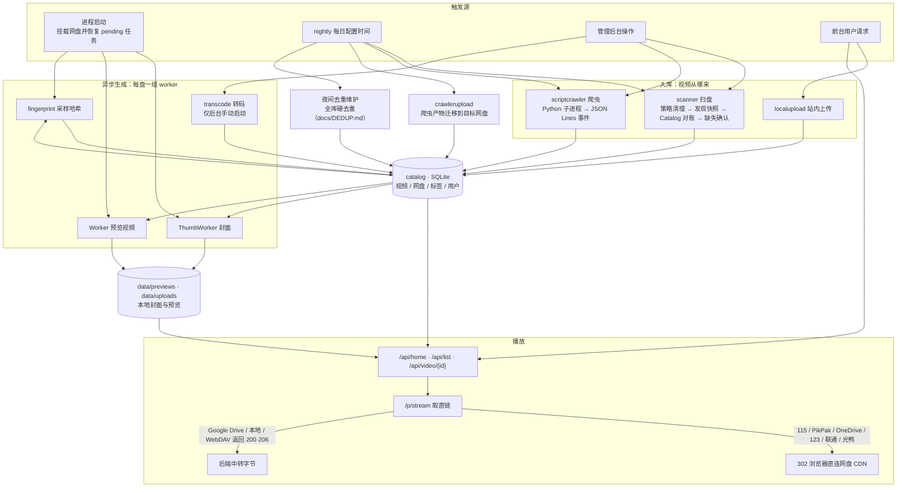
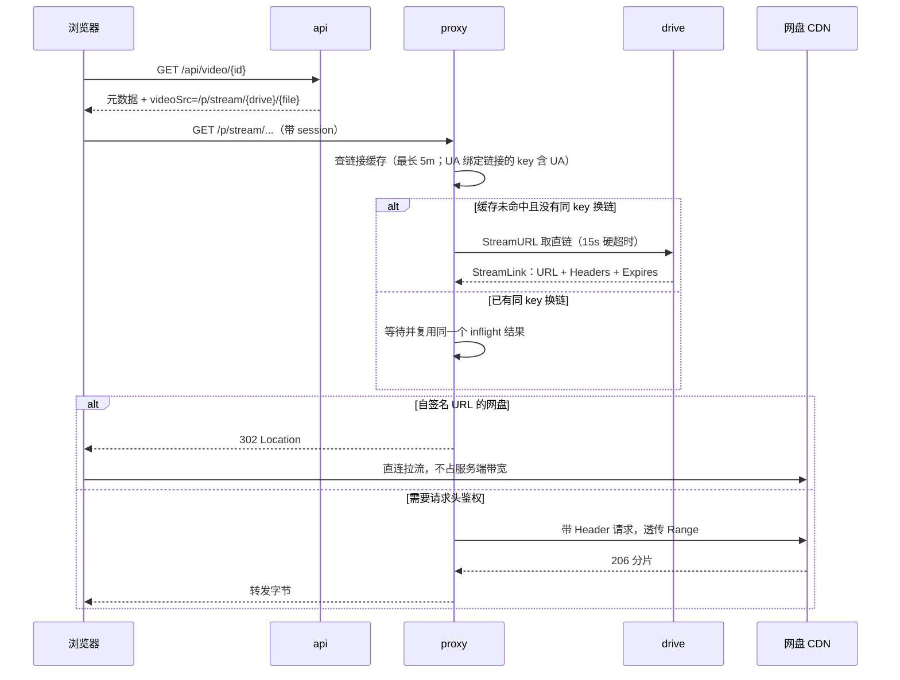
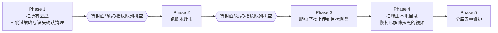

## 快速开始

依赖：**Go 1.27.3+**、**ffmpeg / ffprobe**（用于封面、预览视频、媒体探测/转码和内容级去重，必装；路径可在配置里改）。`sampled_sha256` 指纹由 Go 直接读取 Range 字节计算，不依赖 ffmpeg。SQLite 用纯 Go 驱动（modernc），无需系统库；依赖已 vendored，可离线构建。跑爬虫需要 `python3`。

```bash
cd backend
go run ./cmd/server        # 首次启动自动从 config.example.yaml 生成 config.yaml，监听 127.0.0.1:9192
go test ./...              # 单元测试；缺 ffmpeg / python3 时相关测试自动跳过
go build -o server ./cmd/server
```

前端使用 **Node.js 24.22.1 LTS** 和 **npm 12.2.1**，版本分别由仓库根目录的 `.nvmrc` 和 `package.json` 的 `packageManager` 指定。在仓库根目录运行 `npm run dev` 开发前端，vite 会把 `/api`、`/p`、`/admin/api`、`/peer` 代理到 9192。所有配置项及注释见 [config.example.yaml](config.example.yaml)，正文只在涉及行为时提及个别配置。

每次启动时，服务会先迁移旧版数据库配置，再按随程序打包的 `config.example.yaml` 重建实际配置：保留模板中同名字段的已有值（包括 `false`、`0`、空字符串和空列表），缺失字段使用模板默认值，字段顺序和注释统一采用模板，模板外的字段及自定义注释会被清理。更新完成后原子替换原文件并保留文件权限；配置没有变化时不会重复写入。升级无需手动复制模板，Docker 和原生部署使用同一流程。

## GPU 媒体生成

默认使用 CPU。在配置面板的「媒体生成」中开启「硬件加速」，对应 `generation.use_gpu: true`。保存后用于后续封面和预览任务，无需重启；正在执行的任务沿用开始时的设置，已有资源不会自动重生成。

当前自动检测 Linux VAAPI（Intel / AMD）、NVIDIA NVDEC / NVENC 和 Rockchip MPP / RGA。开启开关时，检测会实际生成 JPEG 封面和 H.264 预览，验证设备、驱动、FFmpeg 滤镜和编码器，而非仅检查编码器列表。开关标题旁在检测时显示「检测中」，开启且检测成功后显示硬件简称，悬停可查看完整名称，关闭开关即隐藏名称；读取名称失败不影响硬件能力检测结果。开启时若没有可用硬件，开关保持关闭，右下角 Toast 提示「未检测到可用的加速硬件」；检测请求失败也通过 Toast 提示，后台读取状态失败不弹出提示。卡片下方不显示错误信息或 CPU 回退统计。视频不兼容或硬件处理失败时，整个资源任务回退 CPU，原因记录在运行日志；网络错误继续使用原有重试策略。

原生部署需要安装匹配的 GPU 驱动，并保证服务进程能访问设备。FFmpeg 需支持 `scale_vaapi` / `h264_vaapi` 或 `scale_cuda` / `h264_nvenc`；Intel 部分平台还需要完整的媒体驱动和固件。封面使用硬件解码和缩放后输出 JPEG；预览使用硬件解码、缩放和 H.264 编码，淡入淡出在缩小后的画面上处理。

Docker 镜像包含 Mesa VAAPI 驱动，amd64 镜像另含 Intel 媒体驱动。默认 Compose 使用 CPU，按设备选择一个附加文件，在仓库根目录启动：

```bash
# Intel / AMD：宿主机需要有 /dev/dri/renderD* 设备
docker compose -f docker-compose.yml -f docker-compose.gpu-vaapi.yml up -d

# NVIDIA：宿主机需安装 NVIDIA 驱动和 NVIDIA Container Toolkit
docker compose -f docker-compose.yml -f docker-compose.gpu-nvidia.yml up -d
```

启动后在面板开启 GPU 开关。没有可用设备时不能通过面板启用；如果恢复的配置或手动编辑的 YAML 已启用 GPU，但设备不可用，服务仍会启动并使用 CPU。当前不支持的其他硬件后端也会视为不可用。

### Rockchip 独立镜像

Rockchip 与其他平台共用应用代码、配置、数据目录和硬件加速开关；独立镜像只提供不同的媒体运行环境。普通镜像继续支持 AMD64 / ARM64；带 `-rockchip` 后缀的镜像只支持 Linux ARM64，例如 `ghcr.io/nianzhibai/91:stable-rockchip`、`main-rockchip`、`v0.3.7-rockchip`（版本标签随实际发布生成）。宿主机必须提供匹配的 MPP / RGA 内核驱动和设备权限；上游要求 Rockchip BSP/vendor 内核，列出的已测试版本为 5.10、6.1，普通 ARM64 主机不因此获得 Rockchip 加速。

首次安装或从普通镜像切换：

```bash
# 首次安装；已有部署改为 bash 91-docker.sh update --image stable-rockchip
bash 91-docker.sh install --image stable-rockchip
# 检测本机设备，生成映射；不改变面板中的加速开关
bash 91-docker.sh gpu
```

然后在面板开启「硬件加速」。脚本识别 `/dev/mpp_service` 或 `/dev/mpp-service`，并只映射实际存在的 `/dev/dri`、`/dev/dma_heap`、`/dev/rga`。无需特权容器。更新时直接运行 `bash 91-docker.sh update`，保留原镜像标签和设备映射；GPU 重新选择及 CPU 模式会清理原有媒体设备映射。切回普通镜像前应先移除 Rockchip 设备映射。脚本通过镜像标签 `io.video-site-91.media-variant=rockchip` 检查运行环境，防止映射仍在时误换普通镜像；自建镜像需要提供相同标签及媒体能力。

手动 Compose 部署可使用 `docker compose -f docker-compose.yml -f docker-compose.gpu-rockchip.yml up -d`。附加文件选择 Rockchip 镜像并列出常见设备，使用前按宿主机实际情况调整设备路径；旧内核的 MPP 节点可能使用连字符。

该后端使用 `-hwaccel rkmpp -hwaccel_output_format drm_prime` 解码，`scale_rkrga` 缩放并转换为 NV12，再下载缩小后的帧供 JPEG 转换或预览淡入淡出处理；预览交给 `h264_rkmpp` 编码。当前要求 MPP 与 RGA 完整管线可用，RGA 不可用或具体素材超出硬件能力时回退 CPU，不承诺所有芯片、分辨率及位深都可加速。设备名称优先从设备树 `compatible` 读取 SoC，失败时显示 `Rockchip VPU`。

镜像通过同一个 Dockerfile 的 `rockchip` target 构建：`docker buildx build --platform linux/arm64 --target rockchip -t video-site-91:rockchip --load .`。当前固定使用 [Rockchip-FFmpeg-Builds 6.1-11](https://github.com/MarcA711/Rockchip-FFmpeg-Builds/releases/tag/6.1-11) 的 ARM64 FFmpeg / ffprobe，两者均校验 SHA256；MPP / RGA 已链接在该构建中，`libx264` 保留用于 CPU 回退。构建时检查 RKMPP、RGA、libx264 能力，普通构建默认使用 `runtime` target。原生部署可以自行安装相同能力的 FFmpeg，并通过 `preview.ffmpeg_path`、`preview.ffprobe_path` 指向配套工具。参考[上游运行要求](https://github.com/nyanmisaka/ffmpeg-rockchip#readme)及[编译说明](https://github.com/nyanmisaka/ffmpeg-rockchip/wiki/Compilation)。

GPU 主机可执行 `cd backend && VIDEO_TEST_GPU=1 go test ./internal/preview -run TestHardwareRealFFmpeg -v`，验证生产使用的封面与预览滤镜链。普通测试环境缺少 GPU 时跳过该实机测试。

## Docker 部署与更新

仓库根目录的 `91-docker.sh` 同时支持首次部署和已有部署的更新，使用系统已安装的 Docker/Compose。需要 Bash、Docker 访问权限和常规 Linux 工具（包括 `flock`、`timeout`、GNU coreutils），Docker Compose 需支持 `config --no-env-resolution`、`--no-normalize` 等选项；缺少 Docker/Compose 或 Compose 版本过旧时会提示并退出。YAML 由 Compose 解析和生成，JSON 合并由宿主机上的 jq 完成，无需 Python。

缺少 jq 时，脚本会自动选择可用的 `apt-get`、`dnf`、`yum`、`apk`、`zypper` 或 `pacman` 安装。root 用户直接安装，其他用户仅对包管理命令使用 sudo，可能需要输入 sudo 密码；更新过程仍以原用户身份执行。已有 jq 时跳过安装。安装失败、权限不足、没有支持的包管理器，或安装后仍无法运行 jq 时退出，此时尚未修改部署配置或更新容器。

首次部署可在空目录执行，无需预先下载 Compose 文件。脚本会从目标镜像读取模板，在本目录创建 `docker-compose.yml` 并启动服务，默认访问端口为 9191，数据挂载到本目录的 `./data`：

```bash
mkdir -p video-site-91
cd video-site-91
curl -fsSL https://raw.githubusercontent.com/nianzhibai/91/main/91-docker.sh -o 91-docker.sh
bash 91-docker.sh install
```

首次部署需要自定义端口或数据目录时，安装命令可改为 `bash 91-docker.sh install --port 8080 --data-dir /srv/video-site-91/data`。这两个选项仅用于首次部署；后续变更请编辑已有 Compose 配置。也可以用 `--image` 指定首次部署的镜像版本。

已有部署在原 Compose 目录下载同一个脚本并执行：

```bash
curl -fsSL https://raw.githubusercontent.com/nianzhibai/91/main/91-docker.sh -o 91-docker.sh
bash 91-docker.sh update

# 可选：保留现有设备配置、改用 CPU，或明确选择显卡类型
bash 91-docker.sh update --gpu keep
bash 91-docker.sh update --gpu cpu
bash 91-docker.sh update --gpu nvidia
bash 91-docker.sh update --gpu vaapi

# 原部署使用固定版本、自定义项目名或多个配置文件时
bash 91-docker.sh update --image ghcr.io/nianzhibai/91:vX.Y.Z
bash 91-docker.sh update --project-name my-project -f docker-compose.yml -f custom.yml
```

重置密码使用运行中的网站容器，沿用服务端的用户选择、随机密码生成和旧会话撤销逻辑：

```bash
# 列出已有用户，交互选择要重置的用户 ID
bash 91-docker.sh reset-password

# 指定已有用户；自定义 Compose 文件和项目名仍可通过 -f / -p 传入
bash 91-docker.sh reset-password --user-id 1
bash 91-docker.sh -f production.yml -p my-project reset-password --user-id 1
```

服务端会生成并在终端显示新的 12 位随机密码。重置要求已有 Compose 配置和运行中的网站容器，直接执行容器内 `/opt/video-site-91/server reset-password`；无需 jq，不安装依赖、不拉取镜像、不重建容器或改写 Compose。可用 `--config` 指定容器内已有的服务端配置路径；默认沿用容器的 `VIDEO_CONFIG` 和工作目录。重置参数不能与安装、更新或 GPU/TG 配置参数混用，执行错误按原退出码返回。

默认的新部署不包含 TG Bot API。启用 TG 部署时执行 `bash 91-docker.sh install --telegram enable`，已有部署执行：

```bash
bash 91-docker.sh update --telegram enable
```

脚本读取已有 Bot API 服务的 `TELEGRAM_API_ID`、`TELEGRAM_API_HASH`；缺少或格式无效时，交互提示输入并校验，API ID 和 API Hash 均明文显示。API ID 为正整数，API Hash 为 32 位十六进制字符串，这两个值从 `my.telegram.org` 获取；已有有效参数直接复用。非交互环境可通过同名环境变量提供，缺失时退出。环境变量也可显式覆盖旧值。Bot Token、接收开关和允许的用户 ID 仍在网站后台配置，脚本不会修改应用的 `config.yaml`。

脚本从目标镜像读取 TG 模板，将 Bot API 服务、网站依赖、共享目录及当前主 Compose 文件的只读挂载写入主文件；拉取 Bot API 镜像并重建网站容器。已有 TG 配置的普通更新也会重建网站容器，使原子替换后的 Compose 文件挂载生效。默认 Bot API 在服务网络内监听 7878，不新增宿主机端口映射。主数据目录为 bind 挂载时，TG 数据默认放在其 `telegram` 子目录；主数据目录为命名卷时，默认创建独立的 `91-telegram-data` 卷。已有 Bot API 镜像、端口和共享目录保留。TG 服务需与网站共享 Compose 网络；主文件中的挂载路径需使用明确路径，不支持变量，自定义 Bot API `command` / `entrypoint` 或 `network_mode` 时需先按项目 TG 部署约定调整。覆盖文件与 TG 连接或存储设置冲突时退出，不覆盖原文件。

启用 TG 后，主 Compose 文件可能包含 API 凭据，权限设为 600。TG 共享目录会写为一致的明确源路径，已有相对路径可能转为绝对路径，仍指向同一份数据。再次执行普通 `update` 或 `--telegram keep` 会保留 TG 部署；不会恢复为默认关闭状态。更新失败会恢复原配置和已有服务镜像；本次新增的 Bot API 容器会被移除，持久数据保留。首次部署失败仍保留配置和数据以便排查。

不传 `install` / `update` 时，脚本会根据主 Compose 文件是否存在自动判断。显式 `install` 拒绝覆盖已有配置，显式 `update` 要求已有配置。默认识别 Compose 环境变量和本目录的标准文件名；可用 `-f` 指定首次生成的文件名及已有覆盖文件。首次部署发现同项目已有服务容器时会退出，要求恢复原部署配置后再更新。

首次部署默认使用 `ghcr.io/nianzhibai/91:stable`，更新默认跟随现有服务的镜像引用；固定旧版本号时需用 `--image` 指定目标版本。脚本先拉取目标镜像，再创建一个不启动的临时容器读取配套部署模板，避免使用 `main` 分支配置搭配旧镜像；临时容器会在退出时删除，配置处理全程在宿主机执行。**需先发布包含更新后的 Dockerfile 和部署模板的镜像**；旧镜像没有模板时会退出并保留原配置。

只有显式执行 `bash 91-docker.sh gpu` 时才检测本机 Linux Docker Engine 的媒体硬件：Intel/AMD 需要 `/dev/dri/renderD*`；NVIDIA 需要正常的驱动和 Docker NVIDIA 运行时；Rockchip 需要 MPP 设备及独立镜像，详见上文。多个候选会提示选择，不自动替用户选卡；没有候选时清理媒体设备映射并使用 CPU。普通安装和更新保留原有配置，不探测宿主机。远程 Docker 或 Docker Desktop 请手动配置设备；驱动、内核和 Toolkit 由宿主机管理员安装。

脚本将需要新增的 GPU 配置直接写入原 Compose 文件，用户不必再下载 GPU 附加文件。它保留已有字段值、端口、数据挂载、环境变量引用、服务 `env_file`、其他服务和资源，新模板只补充缺失的默认配置。配置会经 Compose 重新序列化，注释、锚点和排版不保留；刻意省略的端口、挂载等本机部署字段不会被模板重新添加。默认加载的覆盖文件及 `COMPOSE_FILE` 也会保留使用；自定义 `-f` 文件需要按原顺序传入，GPU 或镜像选择与覆盖文件冲突时会退出而不覆盖文件。

写入前会校验最终配置。更新时在同目录保留带时间戳的 `.bak-*` 原文件并原子替换；首次部署原子创建主文件，检测到其他进程刚刚创建的文件时退出，不覆盖它。`up --wait` 检查容器启动，更新启动失败会恢复原配置，并尝试用更新前的实际镜像 ID 恢复容器；首次部署启动失败则保留生成的配置和数据，便于排查，修复后可执行 `update` 或不带动作重试。容器没有健康检查时，`--wait` 仅确认容器运行，不等同于业务可用性检查。恢复不回滚数据库或应用数据；备份文件可能包含原配置中的敏感值，应与原配置一样保管。

脚本不读取或修改应用的 `config.yaml`，不会自动打开 GPU 开关。更新成功后，在管理后台检测并开启「硬件加速」。自动写入的 GPU 配置会保留在主 Compose 文件中，之后普通镜像升级仍可使用 `docker compose pull && docker compose up -d`；需要同步新版部署模板时再次运行更新脚本。

## 目录

仓库根目录是前端（Vite + React），`backend/` 是本文档描述的 Go 服务：

```
91/
  src/                      前端源码：admin/ 管理后台、pages/、components/、lib/、styles/
  tests/                    前端测试（node --test）
  index.html  public/       前端入口与静态资源
  scripts/  .github/        构建脚本与 CI
  install.sh  start.sh      一键安装、本地启动前后端
  deploy.sh  Dockerfile     部署
  backend/                  Go 服务，见下
```

`backend/` 的主干：

```
cmd/server/                 入口：加载配置、挂载网盘、注册路由、跑启动迁移
internal/
  api/                      前台接口与管理后台路由
  auth/                     管理员登录、会话、失败封禁
  catalog/                  SQLite 元数据与标签
  config/                   YAML 配置
  drives/                   网盘抽象 + 12 个驱动（含 Python 爬虫、站内上传）
  scanner/                  扫盘发现快照、Catalog 对账、文件名解析
  preview/                  ffmpeg 抽封面、生成预览视频
  proxy/                    播放直链代理与 302 策略
  fingerprint/              跨盘去重指纹
  nightly/                  每日维护流水线
  crawlerupload/            把爬虫产物迁移到目标网盘
  mediaimport/              视频导入调度、直链下载和公共入库流程
  telegram/                 Telegram 私聊接收、Local Bot API 文件获取及结果通知
  …                         转码、标签、字幕、相似度、路径与文件名规则等小包
data/                       运行时数据：主库、封面、上传、爬虫产物（不在版本库）
```

<details>
<summary>完整目录（每个包和关键文件）</summary>

### backend/

```
cmd/
  server/                   服务入口与装配
    main.go                 启动、加载配置、跑启动期迁移
    app.go app_status.go    应用状态、按盘的预览开关
    http.go                 chi 路由、CORS、真实 IP 解析
    drives.go               按 kind 构造并挂载网盘
    scan.go                 扫盘准入及发现、对账、清理、派生任务编排
    crawlers.go             脚本爬虫任务调度与凭证
    generation.go           封面 / 预览视频的重生入口
    blacklist.go            历史「隐藏」视频迁移为黑名单墓碑
    tag_maintenance.go      启动期标签迁移与清理
    video_maintenance.go    本地上传文件名迁移 + 夜间全库去重（精确指纹、标题/封面近重复）
    video_maintenance_content.go
                            夜间内容级去重通道：时长相等的视频比较 teaser 对齐帧
  dedupe-dryrun/            预演内容级去重会删哪些视频（默认只读；-apply 真正执行）
  diag-115/ list-115-yingshi/ list-yingshi-children/ trace-parents/
                            一次性诊断工具，读库里的 115 cookie 列目录 / 追父目录，不参与服务运行

internal/
  api/                      REST 路由
    api.go                  前台接口：首页、列表、搜索、详情、点赞、收藏、字幕
    home_recommendations.go 首页推荐
    shorts_feed.go          短视频模式取流
    video_shares.go         一次性免登录分享链接
    storage_usage*.go       存储占用接口（含 unix / windows 分支）
    admin_*.go              管理后台：登录、网盘、爬虫、视频、标签、用户、设置
  auth/                     管理员 session、密码哈希、登录失败封禁
  catalog/                  SQLite 元数据层
    catalog.go              视频、网盘、扫描状态
    tag_*.go                标签 CRUD、匹配、分类、迁移、维护
    users.go video_shares.go
  config/                   YAML 配置与默认值
  drives/
    iface.go                Drive 接口 + 可选能力（Remover、GenerationStreamProvider 等）
    quark/                  夸克（自己实现，参考 OpenList quark_uc）
    p115/                   115（壳子 + SheltonZhu/115driver）
    p123/                   123网盘（含扫码登录）
    pikpak/                 PikPak（自己实现，参考 OpenList pikpak）
    wopan/                  联通网盘（壳子 + OpenListTeam/wopan-sdk-go）
    guangyapan/             光鸭网盘（参考 AList GuangYaPan）
    onedrive/               OneDrive（OpenList 在线续期 + Microsoft Graph 文件接口）
    googledrive/            Google Drive（OAuth 原画中转 + 网页 Cookie 获取 MP4 转码并按访客 UA 302）
    webdav/                 标准 WebDAV（扫描、代理播放、上传、移动和删除）
    localstorage/           本地目录扫描（服务器已有视频目录）
    localupload/            站内上传的伪网盘，文件落在 data/uploads/
    scriptcrawler/          自定义 Python 爬虫驱动
      crawler.go runtime.go 进程管理、事件流解析、v1/v2 协议校验与超时兜底
      metadata.go           CRAWLER_NAME / CRAWLER_PROTOCOL 解析
      dryrun*.go            后台「测试脚本」，含跨平台进程组终止
      neardupe.go           入库前的近重复判定
  scanner/
    scanner.go types.go     扫描入口、进度及 Snapshot / Result / Issue 模型
    discovery.go            只读遍历网盘并生成文件存在性快照
    reconcile.go            快照与 Catalog 对账、去重、标签及墓碑处理
    filename.go             从文件名解析标题和作者
  preview/                  ffmpeg 抽封面、生成多段预览视频，含 worker 队列与限流冷却
  fingerprint/              采样 SHA256 指纹 worker，用于跨盘的文件级去重
  transcode/                探测是否需要转码 + 转码 worker
  proxy/                    /p/stream/*、/p/preview/* 代理与 302 直链策略
  streamhttp/               共享的重定向策略，跳转时不泄漏网盘凭据
  nightly/                  每日一条维护流水线：扫盘 → 爬虫 → 上传迁移 → 去重维护
  crawlerupload/            把爬虫落地的视频迁移到目标网盘并改写 catalog 行
  mediaimport/              视频导入任务、SSRF 防护、磁盘保护和下载 worker
  telegram/                 Telegram 消息幂等、文件去重及机器人通知
  tagging/                  标签匹配规则、番号识别
  mediasim/                 标题相似度 + 封面 SSIM + teaser 帧签名，供近重复判定使用
  mediaasset/               封面 / 预览视频及派生资源的本地路径与文件名规则
  videoname/                扫描、上传、爬虫迁移共用的文件名与标题规则
  storageusage/             磁盘与各网盘占用统计

docs/
  CRAWLER_PROTOCOL.md       crawler.v2 脚本协议
  DEDUP.md                  去重体系：信号、阈值、时机与流程图
config.example.yaml         配置模板
vendor/                     依赖已 vendored，可离线构建
```

以下由运行时生成，不在版本库里：

```
config.yaml                 首次启动从 config.example.yaml 复制
data/video-site.db          SQLite 主库
data/previews/              预览视频及本地媒体资产目录（storage.data_dir 下的 previews）
data/previews/thumbs/       普通封面
data/previews/thumbs-shorts-bg/
                            Shorts 按需生成的 96px 预模糊背景封面
data/previews/framesigs/    内容级去重的帧签名缓存（约 110KB/视频，删了会自动重建）
data/uploads/               站内上传的视频
data/scriptcrawlers/        爬虫落地的视频
data/crawler-scripts/       后台导入的爬虫 .py 脚本
```

</details>

## 运行流程

### 总览



### 1. 启动装配

`cmd/server/main.go` 的顺序是刻意安排的：

1. 读 `config.yaml`（缺失则从模板复制）、建 `data/` 目录、打开 SQLite；迁移旧设置后按当前模板更新配置，再加载最终配置。
2. 挂载本地内置盘（`localupload`），启动指纹补扫协程。
3. 恢复视频直链任务：删除中断的 `.part`，把执行中任务从字节 0 重新排队，并启动唯一下载 worker。
4. 装配 `api.Server` / `api.AdminServer`，注册 chi 路由，挂前端静态资源。
5. **先监听端口**，再 `go attachExistingDrives(ctx)` 异步挂载云盘。云盘挂载要校验上游登录态，放在监听之前会拖慢启动。
6. 启动 nightly 流水线协程，等待退出信号；HTTP 服务关闭后会等待直链 worker 中止请求、清理临时文件并重新排队未完成任务。

启动期还会跑一次性迁移：孤儿视频清理、旧版 config 管理员迁移并移除明文配置、隐藏视频转黑名单墓碑、标签迁移。

每挂载一个盘，就为它单独起 **封面 / 预览 / 指纹三个 worker**，并注册一个可独立取消的 context —— 后台「停止该盘任务」就是取消这个 context。

### 2. 入库的四条路径

| 路径 | 触发 | 关键行为 |
|---|---|---|
| 扫盘 | 夜间流水线、后台「重新扫描」 | 先处理跳过目录策略，再生成存在性快照并与 Catalog 对账，按目录范围完成缺失确认，最后投递派生资产任务 |
| 爬虫 | 夜间流水线、后台「重新扫描」（爬虫盘等同触发爬取） | 启动 Python 子进程，读 stdout 的 JSON Lines 事件流，逐条下载入库 |
| 上传 | 前台 `POST /api/upload` | 落到 `data/uploads/`，直接入库并立即排生成队列 |
| 视频直链 | 上传页 `POST /api/upload/remote` | 持久化后台下载，校验视频流后落到 `data/uploads/`，复用上传生成队列 |

扫盘明确分为五个阶段：

1. **跳过目录策略清理**：挂载并读取配置后的第一个业务阶段，精确清理和老数据补课在这里整体执行，不拆到正常发现之后。仅当跳过名单变化或存在尚未完成补课的跳过目录时实做；根据视频保存的祖先目录链移除命中记录，旧记录按跳过目录分别补课并保存进度。该盘没有空祖先链旧记录时直接完成，不访问网盘。
2. **发现**：只读递归网盘，按扩展名和大小过滤，生成包含候选文件、已见 `file_id`、枚举成功目录 E、打开失败目录 F、策略排除目录 X 及文件祖先链的 `Snapshot`，此阶段不写 Catalog。目录请求超时会原地重试两次，仍失败才进入 F；网盘限流固定冷却 10 分钟后重试同一目录。策略补课与正常发现共享整个网盘本轮任务的预算，最多冷却重试 3 次，第 4 次再限流就结束当前网盘本轮任务。
3. **对账**：解析标题/作者和自动标签，按 `(drive_id, file_id)` 更新已有记录及祖先目录链，执行墓碑及重复检查，并写入新视频。单文件写库失败记录为结构化 `Issue`，不会改变该文件已在快照中出现的事实。
4. **缺失确认与清理**：根据 E/F/X 和每条记录的祖先链逐条判定。失败目录只保护自己的子树，已经成功枚举的兄弟目录仍会推进缺失确认。只有扫盘任务被管理员停止、服务关闭等主动取消时才终止本轮。
5. **派生任务投递**：清理完成后，将本轮新增视频统一交给封面、指纹和预览任务；pending 补扫仍负责进程中断后的兜底。

缺失确认跨扫描任务持久化：第一次符合条件的扫描未见文件只把连续缺失计数记为 1；下一次独立扫描仍能证明其缺失时，计数达到 2，才删除视频记录和本地生成的预览、封面及帧签名。任一后续扫描重新见到文件会立即清零计数。祖先链上遇到打开失败目录 F 或策略排除目录 X 时不会计数；若一个已成功枚举的父目录没有再列出原子目录，则该子树可以正常老化，不必等待整盘零错误。升级前没有祖先链的旧记录在无目录错误的全盘扫描中沿用原有兜底规则。

跳过目录属于管理员策略，不再借用连续缺失确认：保存名单本身不会触发扫描或删除，下一次扫盘开始时才从媒体库移除对应记录，因此期间取消即可保留。取消跳过后，源文件会在后续扫描重新入库，但原记录的手动标签和播放记录不会恢复。两种清理都不删除网盘源文件、不写墓碑；爬虫盘和站内上传盘不参与。

策略清理的数据库查询、本地资产删除或进度写入失败只记录 `[skip-cleanup]` 日志，不阻断后续发现、对账、缺失清理和派生任务。失败项不记录完成状态，下次扫盘自动重试；X 子树中的残留记录仍受缺失清理保护。

#### 视频直链后台任务

上传页的「视频直链」只对管理员开放。创建接口立即返回 `202`，页面通过 `GET /api/upload/remote?limit=20` 展示最近任务；排队或执行中的任务可调用 `POST /api/upload/remote/{jobId}/cancel` 取消。任务保存在 `remote_upload_jobs`，严格由一个 FIFO worker 串行下载，页面刷新或关闭不影响。服务重启会删除中断任务的临时文件并从头下载；普通网络错误不自动重试，重新提交链接即可。完成、失败和取消记录保留 7 天，进入任一终态时原始 URL 会立即从数据库清空，API 和日志始终只使用不含查询参数的主机与路径标签。

直链下载的边界刻意较窄：

- 只接受公网 `http` / `https` 文件 URL，不接受 userinfo、HLS/m3u8、内网/NAS、网页解析或网盘分享页。
- 不提供 Cookie、Referer 或自定义请求头，因此依赖这些鉴权信息的链接不支持；URL 自身带的签名查询参数可以使用，但不会出现在任务响应、错误或日志里。
- 独立 HTTP transport 不读取环境代理。提交、DNS 解析、实际拨号和每次重定向都会拒绝回环、私网、链路本地、组播、未指定、CGNAT和云元数据地址；最多跟随 5 次重定向。
- 连接、TLS 和响应头阶段各有 30 秒超时。下载没有业务大小或总时长上限，但正文连续无数据达到 `remote_upload.idle_timeout_seconds`（默认 120 秒）会失败。
- 已知 `Content-Length` 时会先检查空间，写入每个数据块前也会继续检查，始终保留 `remote_upload.disk_reserve_bytes`（默认 1 GiB）。临时 `.part` 与最终视频在同一 `data/uploads/` 文件系统中。
- 下载结束后必须由 `ffprobe` 确认存在视频流，并只接受 AVI、MKV、MOV、MP4 或 WebM。标题优先级为显式标题、`Content-Disposition` 文件名、最终 URL 文件名、原始 URL 文件名，沿用本地上传的文件名安全与同名冲突规则。
- 最终文件、视频记录、人工标签和任务完成状态按可恢复流程提交；失败会清理文件和数据库记录。成功后仍调用 `OnVideoUploaded`，继续生成封面、预览和指纹。

### 3. 播放链路



设计要点：

- **302 白名单**只放「URL 自带签名、不依赖持久请求头」的播放源：115、PikPak、OneDrive、123网盘、联通、光鸭，以及按访客 UA 签发的 Google Drive 网页兼容 MP4。Google Drive 的原画下载地址必须带 `Authorization`，只能中转；WebDAV 遵循上游 —— 上游给 3xx 就把不含凭据的直链交给浏览器，给 200/206 就由后端转发。
- **链接缓存最长 5 分钟**，且要求离 `link.Expires` 至少还有 15 秒；最多保留 2048 项，满时淘汰最久未使用项。115 等 UA 绑定链接的 cache key 包含 UA。
- 同一个 cache key 的并发请求只发起一次换链，其他请求等待同一个 inflight 结果；换链有 15 秒硬超时，即使某个 driver 不响应 context，也会清掉 inflight 并唤醒等待者。
- `/api/shorts/next` 会在后台预热返回批次中前两条可代理视频的直链，不传输媒体字节；全局最多同时 4 个预热任务，真实播放与预热共用上述缓存和 inflight。
- 每次取链和中转的结果都会回写网盘健康状态。浏览器主动断开、单个文件 404 不算网盘故障，只有真正影响整盘的错误才标记异常。
- 播放器的「三屏画面」可以带 `?tripleScreenRelay=1` 请求强制中转（WebGL 需要同源帧），受 `proxy.allow_forced_relay` 开关控制。

Google Drive 的「兼容播放」使用网页播放接口的 `progressiveTranscodes`，只选择同时包含视频和音频的 MP4，并按清晰度降序提供。管理员在网盘凭证中填写可选的「网页登录 Cookie」后启用；Cookie 应来自拥有视频访问权限的 Google 账号，失效后需要更新，清空可关闭。OAuth 仍负责原文件、扫描和上传，网页 Cookie 失败不会把原文件链路标记为故障。

浏览器同时登录多个 Google 账号时，还需填写「网页账号索引」（`playback_auth_user`），与可正常播放该视频的 Drive 页面 `/u/N/` 中的 `N` 一致，例如 `/file/u/3/d/...` 填 `3`。默认和清空后均使用 `0`。Cookie 对应的默认账号与 OAuth 网盘账号可能不同，索引不匹配会收到权限拒绝。

网页播放按请求的实际 User-Agent 取链，播放源缓存及并发合并按 `driveID + fileID + UA` 隔离；媒体请求也按自己的 UA 查询，避免原生播放器和元数据请求的 UA 不同时串链。驱动只接收 UA 字符串，不接收访客的完整请求头。缺少 UA 时兼容播放不可用，原画播放不受影响。

转码文件使用 `/p/playback/{videoID}/{sourceID}` 鉴权入口，分享使用 `/p/share/{shareID}/playback/{sourceID}`；每个 GET/HEAD 都先校验视频或分享访问权限，再返回不缓存的 302，浏览器直接向 Google CDN 读取媒体。一次解析返回所有可用 MP4 清晰度，切换清晰度无需再次解析元数据；这些站内地址不随上游签名过期，签名更新由后端处理。签名地址通过 Location 下发，Google Cookie 始终留在服务端。三屏画面只保存是否中转，不保存旧播放地址；切换清晰度或刷新后，把 `?tripleScreenRelay=1` 应用到当前地址，在 `proxy.allow_forced_relay` 开启时切回同源中转。中转仅访问供应商白名单，透传 Range/If-Range，不传访客凭据。

网页 Cookie 无效或网页接口返回 401 时，只把兼容源标为不可用并提示更新 Cookie，保留原画播放入口；403（限流除外）提示检查网页登录状态、账号索引和视频权限，不误判整个网盘或 OAuth 凭证失效。

链接缓存不超过签名期限。清晰度消失或中转时签名失效返回 `playback_source_expired`，不视为视频或分享失效；重新解析会返回当前播放源列表，自动选择可恢复到其他清晰度，手动固定的清晰度则保留重试和切换入口。302 后 CDN 错误被媒体元素隐藏时，播放器会先重取一次受支持的 MP4，再按现有有界恢复逻辑处理。该接口为 Google 网页内部接口，字段与内置公开客户端 key 可能随网页更新。

真实 Google 接口测试使用独立的临时数据库和 HTTP 服务，不改动现有视频、账号或分享。把有权访问测试视频的完整 Cookie 请求头值保存到本地文件后运行：

```bash
cd backend
VIDEO_TEST_GOOGLE_DRIVE_COOKIE_FILE=/path/to/google-cookie.txt \
VIDEO_TEST_GOOGLE_DRIVE_FILE_ID=google-video-file-id \
go test ./integration -run '^TestGoogleDrivePlaybackLive$' -count=1 -v
```

测试实际请求 Google 转码接口、按同一 UA 从 CDN 读取 1024 字节，并验证登录及分享入口的 GET/HEAD、302、三屏 Range 中转和匿名访问限制。可通过 `VIDEO_TEST_GOOGLE_DRIVE_AUTH_USER` 指定网页账号索引，通过 `VIDEO_TEST_GOOGLE_DRIVE_USER_AGENT` 指定浏览器 UA。未设置上述两个必需变量时，普通测试跳过这一项；显式启用后，凭证无效、没有可用 MP4 或媒体读取失败都会使测试失败。Cookie 和签名直链不会写入测试日志。

### 4. 异步生成

上传和爬虫产生的新视频会在入库后直接投递；扫盘产生的新视频则在整轮对账及缺失清理完成后，通过 `Result.NewVideos` 统一投递。队列按 video ID 去重，避免同一视频重复排队；每处理完一条 worker 休眠 500ms 节流。

- **封面**：`ffprobe` 探时长 → `ffmpeg` 抽帧。
- **Shorts 背景封面**：第一次请求 `/p/thumb/{videoID}?variant=shorts-bg` 时，从普通封面按需生成最长边 96px、预先模糊的 JPEG，后续直接复用；普通封面更新后会自动刷新。它计入封面存储占用，并随视频或网盘删除一起清理。
- **预览视频**：30 秒以下最多 3 段、30 秒及以上固定 4 段，每段 3 秒。取点区间按时长分档：10 分钟以上在 20%–80% 之间均匀取，30 秒到 10 分钟避开片头片尾（5% 或 3 秒起、85% 前结束），30 秒以下从 10% 起。拼接后校验确有视频流；段数不足时只有在明确的降级路径下才接受 2 段，并留日志。⚠️ **选段起点只由时长决定**——这是内容级去重（[docs/DEDUP.md](docs/DEDUP.md)）帧对齐的正确性依赖，改选段算法必须同步评估那边。
- **指纹**：读少量 Range 片段算 `sampled_sha256`，用于跨盘去重。上传和爬虫在入库后投递，扫盘在完成本轮清理后投递；此外还有每分钟一次的补扫协程捞 `pending`。
- **转码**：不自动跑，由后台按盘手动启动。候选按扩展名圈定：webm（规范上只装浏览器必播编码）和 strm（远程引用）除外都算候选——mp4/m4v 容器兼容但可能装着 MPEG-4 Part 2 / HEVC 等浏览器解不了的视频轨（表现为黑屏有声音）。云盘候选先用 `ffprobe` 远程探测直链（Range 只读容器元数据，MB 级流量），编码兼容的直接标 `skipped` 零下载跳过，需要转码的才整文件下载；mp4/m4v 远程探测失败标 `failed` 等重试，不做整文件下载兜底，避免系统性探测失败时把全库 mp4 拉一遍。单条视频可用 `go run ./cmd/transcode-one <videoID>` 立即处理（走同一流程，目前仅支持 p115）。

**限流冷却**是这一层的横切设计：上游返回 429 / 403 / `activityLimitReached` 这类信号时，整盘进入冷却期，任务保留 `pending` 等下轮，而不是标记失败。联通和光鸭默认冷却 10 分钟。115 的签名链接被提前拒绝时会刷新一次直链重试。

### 5. 夜间流水线

每天按 `config.yaml` 的 `nightly.start_time`（`HH:mm`）跑一次；管理后台的可视化和源码模式都直接修改这份 YAML，修改该字段会立即热更新，不需要重启。旧版 `nightly.cron_hour` 会在启动时一次性迁移。定时流水线的五个阶段**串行**；Phase 1 和 Phase 2 结束时都会等待封面、预览和指纹三个生成队列排空：



定时流水线返回后（包括阶段仅记录错误、整体仍正常返回的情况），会把本次启动日期写入 `settings` 表的 `nightly.last_run_date`；同一天不再自动触发。如果进程在流水线返回前崩溃，日期尚未写入，重启后仍处于配置的触发分钟时可能再次执行。流水线没有固定时长上限 —— 网盘冷却可能让某个阶段跑很久。标签匹配**不在**流水线里全库重算，它是事件驱动的：新视频入库和管理员改标签规则时即时刷新。

新安装不预置内容标签。旧版内置标签升级时自动转为自定义标签，保留标签 ID、匹配规则和视频关联；标签由管理员维护，删除后不会自动补回。番号识别只匹配已有 AV 标签的规则，不生成系列标签。

后台「扫描所有网盘」使用独立的手动执行模式：只运行 Phase 1（扫描网盘管理中配置的非爬虫云盘，并等待新视频的封面、预览和指纹任务排空）以及 Phase 5（全库视频去重）。它不会启动脚本爬虫、爬虫上传或保留视频恢复，也不会写入 `nightly.last_run_date`；手动扫盘与定时流水线仍共享互斥和停止机制。

### 6. 去重体系

去重分布在视频生命周期四个时机——完整的信号定义、阈值、判定流程图见 **[docs/DEDUP.md](docs/DEDUP.md)**。一段话版本：

- **文件级**：`(drive_id, file_id)` 表示同一个源文件；扫描按 `content_hash`（哈希缺失或未命中时以 `file_name + size_bytes` 弱兜底）跳过重复，前台软过滤还会使用 `size_bytes + sampled_sha256`。夜间 Phase 5 的精确硬去重只按 `size_bytes + sampled_sha256` 分组。
- **内容级**：teaser 选段只由时长决定，时长几乎相等的视频比较对齐帧 SSIM（中位数 ≥0.80 判重，时长精确相等时另有交叉匹配兜底），能抓标题、封面完全对不上的跨源转码副本；爬虫导入时同样启用，重复视频在上传网盘前就被挡下。
- **删除语义**：一律打 `reason=duplicate` 墓碑 + 指向保留项，清理本地 teaser、普通封面、Shorts 背景封面和帧签名，**不删网盘源文件**；墓碑阻止重新入库，可在黑名单恢复。

### 7. 鉴权与分享

用户体系两级：`admin` / `user`，没有开放注册，账号由管理后台创建（首次部署时引导设置管理员）。前台的浏览、播放、上传、点赞全部要求登录；`admin` 额外能进管理后台。

管理员凭据仅存储在 SQLite 的 `users` 表，密码保存为 bcrypt 哈希；`config.yaml` 不再支持 `server.admin`。首次设置只写数据库，初始化标记和账号在同一事务中保存，删除或封禁管理员不会重新开放首次设置。升级时，只有尚未初始化且没有用户的数据库会导入旧配置中的非默认管理员凭据；已有数据库账号和密码始终优先，迁移成功后自动移除旧配置字段。旧版不关联用户的登录会话会失效，需要重新登录。

忘记密码时可在线执行 `server reset-password`，选择已有用户 ID；也可用 `server reset-password --user-id 1` 指定目标。一键安装对应 `sudo 91 reset-password`，Docker 可在部署目录执行 `bash 91-docker.sh reset-password`，或直接执行 `docker exec -it video-site-91 /opt/video-site-91/server reset-password`。必须使用包含该子命令的新版服务端；命令不停止或重启服务。

重置命令使用安全随机源生成固定 12 位密码，保证同时包含大写字母、小写字母和数字；数据库提交成功后才在终端显示，数据库只存 bcrypt 哈希。改密和撤销目标用户所有旧会话在同一事务中完成，不创建账号、不修改角色或账号封禁、不解除 IP 封禁或清除失败计数。登录后仍可在后台手动修改密码，不强制二次改密。

命令按 `--config`、`VIDEO_CONFIG`、当前目录 `config.yaml` 的顺序选择配置，数据库相对路径与服务启动一致，基于工作目录解析；直接部署请在服务的工作目录执行。它不会生成缺失配置、创建空数据库或执行启动迁移；备份恢复尚未完成或数据库被替换时会拒绝改密。终端输出含新密码，应避免重定向至公共日志。

前台接口、`/p/stream`、`/p/preview`、`/p/thumb` 全部在鉴权组内，代理路由同样要登录，防止绕过 API 直接拉流。管理接口再加一层管理员校验。

同一来源 IP 在 30 分钟窗口内登录失败 3 次会被封禁。失败计数和封禁记录统一存储在 SQLite，事务保证计数与封禁一致；成功登录清除该 IP 的失败计数，后台解封同时清除封禁与计数。每次服务启动会清空全部登录 IP 封禁和失败计数，不影响账号封禁、密码或已有会话。仅打开数据库或备份不会解封，登录防护状态也不进入备份；只信任本机代理传来的 `X-Forwarded-For` / `X-Real-IP`。

一次性分享是独立链路：`POST /api/share/consume` 用一次性 token 换一个 HttpOnly 分享会话，之后 `/p/share/{shareID}/*` 每次请求都校验该会话，且只能访问绑定的那一个视频。链接首次打开后即失效。

### 8. 日志与排查

- 一键脚本部署（systemd）：前端静态资源、API 与媒体路由由同一个
  `video-site-backend` 服务提供，日志用 `journalctl -u video-site-backend`；
  `start.sh` 模式日志在 `$LOG_DIR`（默认 `/tmp/video-site-91/`）。
- 后端日志按模块带前缀，直接 grep：`[scanner]`、`[scriptcrawler]`、`[nightly]`、`[dedupe-maintenance]` 等。爬虫 Python 子进程的输出并入后端日志。
- 常见排查入口：网盘异常看后台网盘页的健康状态与 `lastError`；预览/封面卡住多半是上游限流，等冷却期过或看 `[nightly]` 是否在等队列排空；去重删了什么搜 `duplicate deleted`，内容匹配过程搜 `content duplicate matched`。
