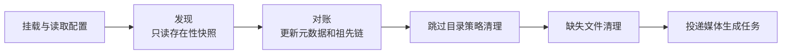
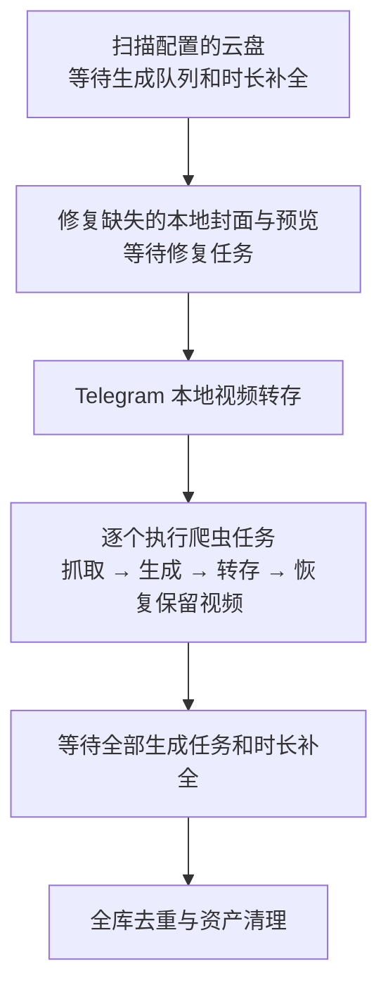

# 后端开发与运行

Go 服务提供 API、媒体代理和前端静态资源，使用纯 Go SQLite 驱动；依赖已放入 `vendor/`，支持离线构建。

> 本文以当前仓库代码为准；部署时请使用配套的管理脚本、发布包或镜像。

使用指南、扩展协议与运行机制见 [文档索引](../docs/README.md)。

## 本地开发

依赖 **Go 1.27.3+**、**Node.js 24.22.1**、**npm 12.2.1**、**ffmpeg / ffprobe**；运行爬虫还需 `python3`。前端版本见根目录 `.nvmrc` 和 `package.json`。

把 `91-web` 克隆到本仓库旁边并安装其依赖，再使用 Linux 开发启动脚本：

```bash
git clone https://github.com/nianzhibai/91-web.git ../91-web
npm --prefix ../91-web ci
FRONTEND_MODE=dev bash start.sh
bash start.sh --status
bash start.sh --stop
```

前端访问 `http://localhost:9191/`，API 与媒体请求代理到 `127.0.0.1:9192`。`FRONTEND_DIR` 可指定其他前端工作区。脚本使用独立的 `backend/config.dev.yaml`，首次创建时将数据目录设为 `backend/data-dev/`；可通过 `BACKEND_PORT` 同时调整后端监听和前端代理端口。不设置 `FRONTEND_MODE=dev` 时，脚本在前端工作区构建并使用 preview 模式，无热更新。

单独运行后端、测试或构建：

```bash
cd backend
go run ./cmd/server                # 默认监听 0.0.0.0:9191
go test ./...
go build -o server ./cmd/server
```

直接运行时使用 `VIDEO_CONFIG` 指定的配置，未设置则读取当前目录的 `config.yaml`，缺失时自动生成。需要同时手动运行 Vite 时，先将后端配置的 `server.listen` 改为 `127.0.0.1:9192`，再在 `91-web` 仓库执行 `npm run dev`。

## 源码部署

在 Linux 仓库根目录执行，脚本会获取锁定的前端发布包、构建后端，并注册 `91.service`。离线构建和前端尚未发布时可使用 `FRONTEND_ARCHIVES` 指定一个目录，其中为锁文件中的每个前端放入与之一致的 `<name>.tar.gz`：

```bash
sudo bash deploy.sh
sudo bash deploy.sh update
sudo bash deploy.sh status
```

Go 服务同时提供前端、API 和媒体入口，新配置默认监听 9191；已有配置和数据保留。配置位于 `backend/config.yaml`，数据默认位于 `backend/data/`。依赖安装主要支持 Debian / Ubuntu；已有完整依赖时可设 `INSTALL_DEPS=0`。

## 配置与数据

配置项、默认值和热更新范围见 [config.example.yaml](config.example.yaml)。启动时迁移旧设置并按内置模板更新配置：保留同名字段的已有值，补齐缺失字段，清理模板外字段及自定义注释；无变化时不重复写入。升级无需手动复制模板。

| 部署方式 | 配置 | 默认数据目录 |
| --- | --- | --- |
| `start.sh` 开发 | `backend/config.dev.yaml` | `backend/data-dev/` |
| 在 `backend/` 直接运行 | `backend/config.yaml` | `backend/data/` |
| 一键安装脚本 | `/opt/91/config.yaml` | `/opt/91/data/` |
| 默认 Docker Compose | `<部署目录>/data/config.yaml` | `<部署目录>/data/` |

数据库默认为数据目录下的 `91.db`，可用 `storage.db_dir` 单独指定数据库目录。数据目录还包含 `previews/`（封面、预览和帧签名）、`uploads/`、`scriptcrawlers/`、`crawler-scripts/`、`telegram/`、日志和备份。

原生运行的相对路径基于进程工作目录解析。容器默认配置和版本文件随所选数据目录确定，可用 `VIDEO_CONFIG`、`VIDEO_VERSION_FILE` 覆盖。旧安装的目录与服务名处理见 [旧部署升级](#旧部署升级)。

## Docker 部署与更新

根目录的 `91-docker.sh` 使用已安装的 Docker / Compose。宿主机需有 Bash、`flock`、`timeout` 和 GNU coreutils；Compose 需支持 `config --no-env-resolution`、`--no-normalize`。脚本需要 jq 时会尝试通过系统包管理器安装，非 root 用户可能需要 sudo。

首次部署可在空目录执行，镜像应包含与脚本配套的部署模板：

```bash
mkdir -p 91
cd 91
curl -fsSL https://raw.githubusercontent.com/nianzhibai/91/main/91-docker.sh -o 91-docker.sh
bash 91-docker.sh install
```

默认使用 `ghcr.io/nianzhibai/91:stable`，对外端口为 9191，数据挂载到 `./data`。端口和存储挂载通过 Compose 文件配置。移动已有数据前先停服并保留原数据，再同步修改挂载与相关路径配置。

在原部署目录更新：

```bash
bash 91-docker.sh update
# 指定目标镜像，将 vX.Y.Z 替换为实际发布标签
bash 91-docker.sh update --image ghcr.io/nianzhibai/91:vX.Y.Z
# 通过环境变量沿用自定义文件组合和项目名
COMPOSE_FILE=docker-compose.yml:custom.yml COMPOSE_PROJECT_NAME=my-project bash 91-docker.sh update
# 交互选择用户并重置密码
bash 91-docker.sh reset-password
```

`update` 默认先从仓库 `main` 分支更新管理脚本，更新脚本失败时继续使用本地版本。设置 `SELF_UPDATE=0` 可跳过，`DOCKER_SCRIPT_URL` 可指定脚本下载地址；其他命令不触发自更新。

更新沿用当前镜像引用，可用 `--image` 指定目标。脚本从目标镜像读取模板，保留现有端口、挂载、环境变量和其他服务，补充缺失默认项；镜像缺少模板时退出。自定义文件组合和项目名可通过 `COMPOSE_FILE`、`COMPOSE_PROJECT_NAME` 保存到 `.env`。

配置通过校验后才会写入，原文件保留为 `.bak-*`。主配置会重新序列化，旧名称迁移还会重写相关附加配置，注释、锚点和排版不保证保留。`up --wait` 在没有健康检查时只确认容器运行；失败处理见下节。

Telegram 部署和后台配置见 [接入 Telegram](../docs/TELEGRAM.md)。脚本不修改应用配置，也不自动启用 GPU。

## 旧部署升级

使用新版管理脚本和包含 `91` 发布包或部署模板的版本。旧部署保留原安装目录及数据；更新命令如下：

| 部署方式 | 更新命令 | 迁移行为 |
| --- | --- | --- |
| 一键安装 | `91 update` | 切换默认服务名并记住实际安装路径，保留自定义服务名 |
| 源码部署 | `sudo bash deploy.sh update` | 停用旧源码服务，启用 `91.service` |
| Docker | `bash 91-docker.sh update` | 迁移旧服务名、默认容器名及参与部署的附加配置，保留端口、挂载、自定义容器名和 GPU 设置 |

旧 Docker 脚本若尚不支持自更新，先在原部署目录重新下载脚本：

```bash
curl -fsSL https://raw.githubusercontent.com/nianzhibai/91/main/91-docker.sh -o 91-docker.sh
bash 91-docker.sh update
```

Docker 继续使用旧数据挂载。匿名数据卷需先改为显式挂载；存在新旧两套数据时，用 `VIDEO_DATA_DIR` 指定所用目录。外部 `extends.file` 配置及其服务引用保持原样，不会随部署文件自动更名。

停用旧服务后首次启动新版，会将 `video-site.db` 迁移为 `91.db`；新旧两个独立数据库同时存在时拒绝启动。已有待恢复备份会先按原文件名完成恢复，再迁移数据库名。

一键安装的更新成功后，会移除旧的 `video-site-91` 命令。

### Telegram Bot API 部署

新版不再使用 Bot API 服务。旧配置中已启用的 Telegram 会在首次启动时自动关闭，Bot Token 和允许的用户 ID 保留；在「配置面板 → Telegram」填写 API ID / API Hash 后重新启用。

| 部署方式 | 旧 Bot API 的处理 |
| --- | --- |
| 一键安装 | 更新成功后移除 Bot API 容器。原 `telegram.yml` 改名为 `telegram.yml.retired`，其中的 `TELEGRAM_API_ID` / `TELEGRAM_API_HASH` 即需填写的凭据，填写后可删除该文件 |
| Docker | 凭据位于 Compose 文件中 `telegram-bot-api` 服务的环境变量。更新后手动删除该服务，以及网站服务中对它的 `depends_on`、`VIDEO_TELEGRAM_COMPOSE` 环境变量和该变量指向的只读挂载，保留 Telegram 数据挂载，再执行 `docker compose up -d --remove-orphans` |

### 更新失败时

管理脚本按以下规则处理失败，**不会回滚数据库或应用数据**：

| 更新场景 | 处理方式 |
| --- | --- |
| 原生更新 | 新版启动前失败时恢复旧文件和服务；新版开始启动后失败时保留新版程序、配置和数据并停服 |
| Docker 更新，数据库文件名未变化 | 恢复 Compose 配置，并尝试用更新前的本地镜像恢复容器 |
| Docker 更新，跨数据库文件名 | 尝试启动新版前失败时可回退；尝试启动后失败时保留新版配置并停服 |

修复启动问题后重试更新，原生更新可重试同一版本。Docker 首次部署失败会保留配置和数据，修复后执行 `update`。运行只识别旧数据库文件名的版本前，必须先停服并处理文件名，不能直接启动旧程序。

## GPU 媒体生成

默认使用 CPU。在配置面板「媒体生成」中开启硬件加速，对后续封面和预览任务生效，无需重启；已有资源不自动重生成。检测会实际生成 JPEG 和 H.264 预览，无可用设备时无法通过面板启用。已启用的配置遇到设备不可用或素材不兼容时回退 CPU，原因写入日志。

| 后端 | 宿主机与 FFmpeg 要求 | 手动 Compose 附加文件 |
| --- | --- | --- |
| Intel / AMD VAAPI | `/dev/dri/renderD*`、匹配驱动，FFmpeg 支持 `scale_vaapi` / `h264_vaapi` | `docker-compose.gpu-vaapi.yml` |
| NVIDIA | NVIDIA 驱动、Container Toolkit，FFmpeg 支持 `scale_cuda` / `h264_nvenc` | `docker-compose.gpu-nvidia.yml` |
| Rockchip MPP / RGA | ARM64、匹配的 BSP/vendor 内核与 MPP/RGA 设备、Rockchip 镜像 | `docker-compose.gpu-rockchip.yml` |

原生部署需保证服务进程有设备权限，可通过 `preview.ffmpeg_path` / `ffprobe_path` 指定工具。普通 Docker 镜像包含 Mesa VAAPI 驱动，amd64 另含 Intel 媒体驱动。

使用脚本时，在本机 Linux Docker Engine 上检测并选择设备：

```bash
bash 91-docker.sh gpu
```

`gpu` 独立检测并选择设备；普通安装和更新保留设备配置，不接收 `--gpu` 参数。远程 Docker / Docker Desktop 需手动配置。手动 Compose 示例，在仓库根目录执行：

```bash
docker compose -f docker-compose.yml -f docker-compose.gpu-vaapi.yml up -d
```

### Rockchip

Rockchip 镜像仅支持 Linux ARM64，标签为 `stable-rockchip`、`main-rockchip` 或 `<版本>-rockchip`。MPP 和 RGA 管线都需可用，普通 ARM64 主机不因此获得加速。

```bash
# 首次安装；已有部署将 install 改为 update
bash 91-docker.sh install --image stable-rockchip
bash 91-docker.sh gpu
```

脚本识别 `/dev/mpp_service` 或 `/dev/mpp-service`，按实际设备映射 `/dev/dri`、`/dev/dma_heap`、`/dev/rga`，无需特权容器。手动使用 Rockchip Compose 附加文件前需调整设备路径。切回普通镜像前移除 Rockchip 映射；脚本会检查镜像的 `io.91.media-variant=rockchip` 标签。

独立镜像使用同一 Dockerfile 的 `rockchip` target，固定媒体工具来源及校验见 [Dockerfile](../Dockerfile)。可自行构建：

```bash
docker buildx build --platform linux/arm64 --target rockchip -t 91:rockchip --load .
```

GPU 主机可运行 `cd backend && VIDEO_TEST_GPU=1 go test ./internal/preview -run TestHardwareRealFFmpeg -v` 验证实际滤镜链。

## 代码结构

| 路径（相对 `backend/`） | 职责 |
| --- | --- |
| `cmd/server/` | 启动装配、网盘任务、扫描清理、媒体生成和维护 |
| `internal/api/`、`internal/auth/` | API、后台、用户与会话鉴权 |
| `internal/catalog/`、`internal/config/` | SQLite 元数据、YAML 配置及迁移 |
| `internal/drives/` | 网盘驱动、本地存储、上传与 Python 爬虫 |
| `internal/scanner/` | 只读发现快照、Catalog 对账、文件名解析 |
| `internal/preview/`、`internal/fingerprint/` | 封面、预览和采样指纹 |
| `internal/proxy/`、`internal/streamhttp/` | 媒体代理、直链缓存和重定向策略 |
| `internal/mediaimport/`、`internal/telegram/`、`internal/crawlerupload/` | 导入、Telegram 接收和爬虫产物转存 |
| `internal/nightly/`、`internal/dedupe/`、`internal/mediasim/` | 定时编排、去重计划和相似度算法 |

官方前端源码和 UI 测试位于独立的 `nianzhibai/91-web-nostalgic`（默认）和 `nianzhibai/91-web` 仓库。本仓库的 `sdk/` 提供客户端库，`tests/` 验证 SDK、接口约定和部署脚本；`scripts/` 与 `.github/` 负责产品构建发布。前端安装、切换及版本锁定见 [前端版本与发布](../docs/FRONTEND_RELEASES.md)。

## 运行流程

### 启动与入库

服务加载配置、处理待恢复备份、打开数据库并执行迁移，装配 API、媒体路由和前端静态资源；监听端口后异步挂载已有云盘，避免上游登录校验阻塞启动。未完成的直链下载从头排队，媒体生成任务由 pending 补扫恢复。

| 来源 | 触发与处理 |
| --- | --- |
| 扫盘 | 后台单盘扫描、扫描所有网盘、定时维护；发现、对账和清理后统一投递新视频的生成任务 |
| 爬虫 | 后台或定时执行；仅接受 [crawler.v3](../docs/CRAWLER_PROTOCOL.md)，依次发现、解析、下载、入库、生成、转存和恢复保留视频 |
| 本地上传 | `POST /admin/api/upload`，写入 `uploads/` 后入库并排生成任务 |
| 视频直链 | 管理员提交 `POST /admin/api/upload/remote`，持久化任务串行下载，验证视频流后复用上传流程 |
| Telegram | 私聊机器人导入本地媒体库，配置目标网盘后由定时维护转存 |

### 扫描清理



- **缺失清理**：当前配置范围完整扫描后，立即删除已确认消失的记录；发现不完整时只对可证明缺失的记录累计两次确认，失败和排除目录的子树受保护。重新看到文件会清零计数。
- **跳过目录**：保存名单只写配置，下次扫描对账后清理；此前取消可保留记录。清理使用更新后的祖先链，并保护本轮已见文件，避免把移出跳过目录的视频误删。
- 两种清理都删除库记录和本地生成资产，不写墓碑、不删网盘源文件；取消跳过后可重新扫描入库，原手动标签和播放记录不恢复。爬虫、站内上传和 Telegram 本地盘不参与。

目录判定、重试、旧数据处理和已知边界见 [扫盘清理](../docs/SCAN_CLEANUP.md)。

### 异步生成

各盘有独立队列，封面、预览和指纹各自使用所有来源共享的并发额度，见 `generation.*_concurrency`。上传和爬虫入库后直接投递；扫盘在本轮清理后投递。pending 补扫负责中断恢复。

- **封面**：`ffprobe` 探测时长，`ffmpeg` 抽帧。Shorts 背景首次请求 `/p/thumb/{videoID}?variant=shorts-bg` 时，从普通封面生成最长边 96px 的模糊 JPEG；原封面更新时刷新，随视频一起清理。
- **预览**：30 秒以下最多 3 段，30 秒及以上固定 4 段，每段 3 秒。10 分钟以上在 20%–80% 均匀取点；30 秒到 10 分钟避开片头片尾（5% 或 3 秒起、85% 前结束）；30 秒以下从 10% 起。段数不足时仅在明确降级路径接受 2 段并记录日志。**选段起点只由时长决定，是内容去重帧对齐的前提**，修改算法须同步评估 [去重体系](../docs/DEDUP.md)。
- **指纹**：Go 读取少量 Range 字节计算 `sampled_sha256`，不依赖 ffmpeg。

上游限流会触发盘级冷却，生成任务保留 pending 等待后续执行；115 签名链接提前失效时刷新一次重试。

### 定时维护

调度由 `nightly.start_time`、`timezone` 和 `disabled` 控制，保存后热更新。阶段依次执行，云盘扫描可跨盘并发，单个爬虫完成自身生命周期后才处理下一个：



后台「扫描所有网盘」执行云盘扫描、本地资产修复和全库去重；与定时维护共享互斥和停止机制，不执行 Telegram 转存或爬虫任务，也不写定时执行日期。

定时流水线返回后将启动日期写入 `nightly.last_run_date`，当天不再自动触发；阶段记录错误后继续并正常返回的情况也会记日期。返回前崩溃且重启时仍在触发分钟内，可能重跑。流水线无固定总时限，管理员停止或服务退出会取消任务。

标签在视频入库和规则变更时更新，不在维护中全库重算。新安装不预置内容标签；旧版内置标签迁移为自定义标签，保留 ID、规则和关联。

### 去重

扫描入库检查原生哈希及文件名加大小的弱兜底；前台软过滤还使用采样指纹。全库硬去重依次执行采样指纹、标题/封面、内容帧三个通道。

硬去重先合并标签、反应、计数、分享和历史引用，再为重复行写 `reason=duplicate` 墓碑并指向最终保留项，提交后清理本地资产。**不删除网盘源文件；重复项不能从后台恢复**，旧公开 ID 会解析到保留项。阈值、选择规则和预演工具见 [去重体系](../docs/DEDUP.md)，内部 SQL 审计见 [重复决策记录](internal/dedupe/RECORDS.md)。

## 播放

普通视频入口先鉴权，再由 `/p/stream/{drive}/{file}` 获取直链：

- 驱动通过 `ClientRedirectSafe` 标记可交给浏览器的直链，返回 302；依赖服务端鉴权头的源由后端中转。WebDAV 按上游返回的 3xx 或 200/206 决定直连或中转。
- 直链最多缓存 5 分钟，离过期不足 15 秒时重新获取，最多 2048 项；UA 绑定链接按 UA 隔离。同 key 并发合并，取链硬超时为 15 秒。
- Shorts 批次预热前两条可代理视频的直链，全局最多 4 个任务，不预下载媒体。
- 三屏画面使用 `?tripleScreenRelay=1` 强制同源中转，受 `proxy.allow_forced_relay` 控制。

兼容播放使用网盘提供的 HLS 或 MP4，按驱动能力提供清晰度。115 在用户请求播放时可提交上游转码；列出播放源和预热不会启动转码。HLS 经站内鉴权中转，播放列表、密钥、分片及重定向均受供应商主机白名单限制。

Google Drive 原画使用 OAuth 鉴权中转；兼容 MP4 需填写有访问权限账号的「网页登录 Cookie」，多账号时还需匹配 Drive 页面 `/u/N/` 的「网页账号索引」，默认 `0`。兼容源按实际 UA 取链并向 Google CDN 返回 302；Cookie 仅保留在服务端，失效不影响 OAuth 原画入口。

兼容播放使用网页内部接口，可能随上游变化。真实接口验证使用临时数据库和 HTTP 服务：

```bash
cd backend
VIDEO_TEST_GOOGLE_DRIVE_COOKIE_FILE=/path/to/google-cookie.txt \
VIDEO_TEST_GOOGLE_DRIVE_FILE_ID=google-video-file-id \
go test ./integration -run '^TestGoogleDrivePlaybackLive$' -count=1 -v
```

可用 `VIDEO_TEST_GOOGLE_DRIVE_AUTH_USER` / `VIDEO_TEST_GOOGLE_DRIVE_USER_AGENT` 指定账号索引和 UA；未设置两个必需变量时跳过测试。

## 视频直链任务

管理员提交后立即返回 `202`；`GET /admin/api/upload/remote?limit=20` 查询最近任务，`POST /admin/api/upload/remote/{jobId}/cancel` 取消。唯一 FIFO worker 串行下载，页面关闭不影响；重启从头下载，普通网络错误需重新提交。

仅接受公网 HTTP(S) 文件地址，不接受 HLS、内网、网页解析或网盘分享页，不提供 Cookie、Referer 或自定义头。提交、DNS、拨号及每次重定向都校验地址，最多重定向 5 次，下载不使用环境代理。

下载无业务大小或总时长上限，正文无数据超时默认 120 秒，磁盘预留默认 1 GiB；参数见 `remote_upload`。结束后须由 ffprobe 验证视频流，仅接受 AVI、MKV、MOV、MP4、WebM。失败清理文件和库记录；终态记录保留 7 天并立即清空原始 URL，API 和日志不输出签名查询参数。

## 鉴权与分享

用户分 `admin` / `user`，首次部署引导创建管理员，后续账号由后台创建，无开放注册。浏览、播放、上传及互动需登录，管理接口另校验管理员。密码以 bcrypt 哈希存入 SQLite；首次初始化完成后，删除或封禁管理员不会重新开放设置。

忘记密码可在原服务工作目录执行 `./server reset-password --user-id 1`，省略 ID 时交互选择。一键安装用 `sudo 91 reset-password`，Docker 用上文脚本或 `docker exec -it 91 docker-entrypoint.sh ./server reset-password`。命令生成并显示 12 位随机密码，同时撤销该用户旧会话，不重启服务。配置选择顺序为 `--config`、`VIDEO_CONFIG`、当前目录 `config.yaml`；不会创建缺失配置或数据库。

同 IP 在 30 分钟内登录失败 3 次会被封禁；成功登录清除失败计数，后台解封同时清除计数。服务启动清空登录 IP 封禁及失败计数，不影响账号封禁或已有会话；仅信任本机代理的转发 IP 头。

一次性分享通过 `POST /api/share/consume` 将 token 换成最长有效 6 小时的 HttpOnly 分享会话，链接首次消费后失效。随后 `/p/share/{shareID}/*` 每次验证会话且只能访问绑定视频。

## 备份与恢复

后台「备份恢复」（`/admin/backup`）可选择云盘、爬虫、上传存储、本地存储和用户信息创建备份。备份位于 `storage.data_dir` 下的 `backups/`，可下载，也可上传或通过接收码传送到另一台服务器。

恢复前展示校验结果和恢复范围；确认后暂存数据，通过重启应用完成切换，恢复后需重新登录。受支持的 systemd / Docker 部署会自动重启，手动运行需自行重启后端。当前只接受格式版本 3 的备份，旧文件名前缀仍可识别。跨服务器迁移后应核对本机配置及外部存储路径。

## 日志与排查

- 一键安装：`journalctl -u 91`；Docker：`docker compose logs -f`；开发脚本：`$LOG_DIR`，默认 `/tmp/91-dev/`。
- 网盘异常看后台健康状态和 `lastError`；扫描查 `[scan]` / `[scanner]`，策略清理查 `[skip-cleanup]`，缺失清理查 `[cleanup]`。
- 去重查 `[dedupe-maintenance]` 的 `duplicate merged` / `content duplicate matched`；生成停滞查看限流冷却及 `[nightly]` 队列等待日志。
