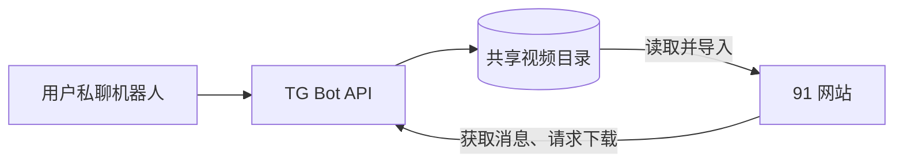

# 接入 Telegram

项目通过本地 TG Bot API 获取私聊视频。Bot API 与网站必须共享下载目录，后台只配置机器人及接收规则。



## 准备凭证

- **Bot Token**：向 Telegram 的 `@BotFather` 发送 `/newbot` 创建机器人。
- **API ID / API Hash**：在 `my.telegram.org` 的 API development tools 申请。API ID 为正整数，API Hash 为 32 位十六进制字符串。

## 部署 Bot API

### 一键安装脚本部署的网站

编辑安装目录中的 `telegram.yml`，在已有 `environment` 下填写 `TELEGRAM_API_ID` 和 `TELEGRAM_API_HASH`，然后启动 Bot API 并重启网站：

```bash
cd /opt/video-site-91
sudo nano telegram.yml
sudo docker compose -f telegram.yml up -d --pull always
sudo 91 restart
```

该方式默认将 Bot API 端口绑定到 `127.0.0.1:7878`，共享目录为安装目录的 `data/telegram/`。

### Docker Compose 部署的网站

在原 Compose 部署目录下载管理脚本并启用 Telegram：

```bash
curl -fsSL https://raw.githubusercontent.com/nianzhibai/91/main/91-docker.sh -o 91-docker.sh
bash 91-docker.sh update --telegram enable
```

首次部署用 `bash 91-docker.sh install --telegram enable`。脚本复用已有 API 凭证，缺失或无效时交互输入；非交互环境通过 `TELEGRAM_API_ID` / `TELEGRAM_API_HASH` 环境变量提供，也可覆盖旧值。交互输入明文显示，包含凭证的主 Compose 文件权限设为 600。

脚本保留网站配置并合入 Bot API 服务、共享挂载和依赖，然后重建容器。默认在服务网络内使用 7878，不新增宿主机端口；bind 数据目录使用其 `telegram/` 子目录，命名卷部署默认创建独立 TG 卷。后续普通 `update` 保留 Telegram 部署。

自定义 Compose 文件按原顺序通过 `-f` 传入，必要时用 `-p` 指定项目名。脚本要求支持所需选项的 Compose，缺少模板或发现连接/存储配置冲突时退出；更新失败尝试恢复原配置和镜像，不回滚数据。完整更新规则见 [后端部署说明](../README.md#docker-部署与更新)。

手动部署可参考 [TG Compose 模板](../../tg-docker-compose.yml)，将 Bot API 服务、网站环境变量、共享目录及配置文件挂载合入现有配置；保留原端口、数据挂载和其他服务。模板将当前 `docker-compose.yml` 只读挂载为容器内 `telegram.yml`，改用其他文件名时需同步调整。

## 网站后台配置

1. 在「配置面板 → Telegram」填写 Bot Token，启用并保存，再到 Telegram 页面测试连接。
2. 私聊机器人发送 `/id`，将回复的数字填入「允许的用户 ID」并保存；名单为空时仅响应引导消息，不接收视频。
3. 向机器人发送视频，检查导入结果。可选填站点地址以生成回复链接。

视频默认保存在媒体库本地目录。配置「上传网盘」和目标目录后，由定时维护转存；保存配置不会立即启动转存，停用网站接收也不会停止 Bot API 容器。
