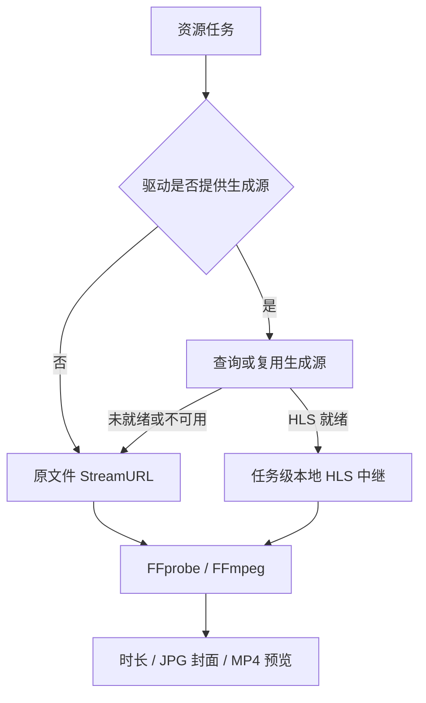

# 视频资源生成取流

封面、预览视频和缺失时长补全共用 `GenerationStreamProvider`。支持的网盘自动优先使用就绪的云端 HLS；其他驱动使用 `StreamURL`，无需额外配置。

| 网盘 | HLS 来源 | 生成策略 |
| --- | --- | --- |
| 115 | 在线播放主清单 | 沿用最高带宽子清单及现有缓存、扫描重置机制 |
| 夸克 | `/file/v2/play` | 按清晰度从高到低选择就绪的 HLS；每次媒体请求读取最新 Cookie |
| 联通 | `VideoDisplayFiles` | 使用匹配文件的 `m3u8` |
| 移动 | `/videoPreview/getPreviewInfo` | 仅使用 `Finished` 且地址有效的源 |

生成只消费就绪源，不轮询转码，也不额外调用转码准备接口。夸克使用现有播放查询端点，其服务端是否隐式启动准备由上游决定。

## 生命周期与恢复

- 生成与在线播放独立缓存。夸克、联通、移动按挂载驱动和文件合并并发取链，成功缓存最多两分钟且不超过链接期限；不可用结果按文件缓存 30 秒。强制刷新不复用旧的普通取链请求。
- HLS 清单、子清单、分片、初始化片段和密钥统一经过任务的本地中继。账号头留在 Go 进程内；需要账号鉴权的请求和重定向必须符合驱动的主机策略。
- 时长探测与资源生成共用一次刷新预算。签名拒绝可刷新一次：115、联通、移动为 403，夸克为 403/412。仍失败或解码失败时回退原文件。
- 中继遇到上游拒绝时取消当前源的媒体命令及在途请求，并阻止后续取流；真实错误在命令结束时传回，先于换片段或硬件回退。外层任务仍可刷新或切换原文件。
- 明确的 405/429 限流保留状态及 `Retry-After`，进入现有任务冷却机制；账号失效和任务取消不触发原文件回退。没有探测出时长不视为 HLS 故障，继续使用未知时长的生成策略。
- 任务结束、切换源或取消时关闭中继。文件指纹仍读取原文件字节。

代码入口：[生成接口](../internal/drives/iface.go)、[生成源缓存](../internal/generationsource/cache.go)、[任务恢复](../internal/preview/generation_source.go)、[HLS 中继](../internal/hlsrelay/loopback.go)。
