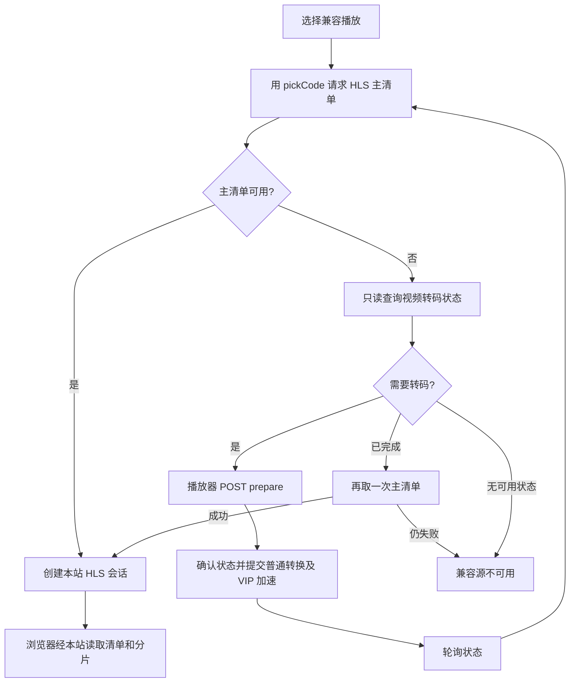
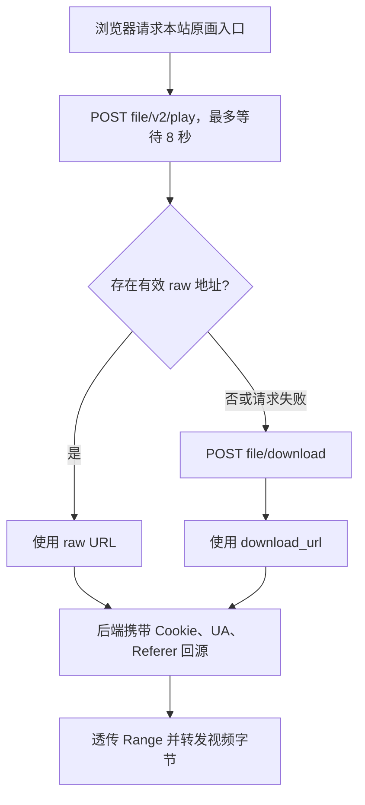
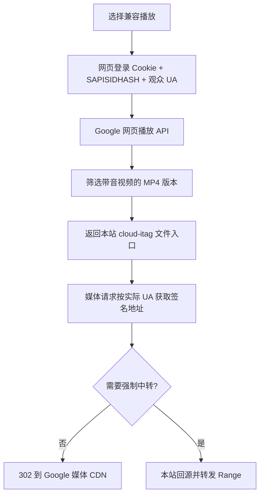

# 网盘在线播放链路

播放器如何发起请求、后端如何获取播放地址、视频字节如何到达浏览器，以及取链失败或地址失效时的处理。后台封面、预览与时长任务见[视频资源生成取流](RESOURCE_GENERATION.md)。

## 1. 115 网盘（p115）

### 原画播放

链路：浏览器 → 本站原画入口 → 获取 pickCode → 按浏览器 UA 换链 → 302 → 115 下载服务器。

1. 浏览器请求 `GET /p/stream/{driveID}/{fileID}`，携带自身 `User-Agent` 和所需的 `Range`。
2. 代理调用 `StreamURLWithHeader`，把浏览器 UA 传给 115 驱动；取链使用后台配置的 115 Cookie。
3. 驱动先从内存读取 `fileID → pickCode`，没有缓存时查询文件元数据。115 下载接口使用的是 `pickCode`，不能直接传站内视频 ID 或文件 ID。
4. 调用 SDK `DownloadWithUA(pickCode, UA)`，实际请求 `POST https://proapi.115.com/app/chrome/downurl`：对包含 `pickcode` 的请求体编码，再解码响应中的下载 URL 和请求头。
5. 如果上游明确报告缓存的 pickCode 不存在，驱动重新查询文件元数据后再取链一次；其他错误直接返回。
6. 驱动返回允许浏览器直取的链接，本站向浏览器返回 302。浏览器使用自身 UA 向 115 下载服务器读取媒体，视频字节不经过本站。
7. 请求 `tripleScreenRelay=1` 且配置允许强制中转时，本站改为携带 SDK 返回的请求头回源，透传 `Range`，将媒体流转发给浏览器。

原画缓存按完整浏览器 UA 隔离。驱动给出的链接复用期限为 25 分钟，代理实际最多缓存 5 分钟，并在链接到期前 15 秒停止复用；刷新原画地址后重新走上述换链流程。

### 兼容播放



1. 播放器请求 `GET /api/video/{videoID}/playback?source=cloud`，驱动按 fileID 找到 pickCode。
2. 后端请求 `GET https://115.com/api/video/m3u8/{pickCode}.m3u8`，携带账号 Cookie、固定播放 UA 和 `Referer: https://115.com/`。
3. 主清单有效时，驱动返回 `cloud` HLS 源，保留完整主清单及音轨信息。账号 Cookie 只用于后端获取主清单，不放进返回的媒体链接头中。
4. 本站建立 HLS 会话，向浏览器返回 `/p/hls/{videoID}/{sessionID}/index.m3u8`。清单中的子清单、分片、密钥等地址改写为同源资源地址，后端只回源允许的 `.115.com` 资源。
5. 主清单暂不可用时，请求 `GET https://webapi.115.com/files/video?pickcode=...&local=1` 检查状态；此请求只查询，不提交转码。
6. 返回文件 ID 匹配、`file_status=0` 且 SHA1 有效时，向播放器返回 `processing` 和 `prepareUrl`。如果状态已完成，则再尝试一次主清单。
7. 当前播放器对 `prepareUrl` 发 POST 后，驱动复查状态，必要时请求不带 `local=1` 的视频接口进入普通转换，再调用 `POST https://115.com/?ct=play&ac=push`，提交 `op=vip_push`、`pickcode`、`sha1`。
8. 提交按 `fileID/SHA1` 去重，30 分钟内不重复提交；即使提交超时也保留记录。播放器约每 15 秒查询一次，最多等待 5 分钟，离开当前视频时停止等待。

兼容播放的清单和分片经过本站服务器。HLS 会话每次访问延长 30 分钟闲置期限；上游签名被拒绝时，播放器可重新解析一次兼容源。115 的 405/429 限流会中止继续尝试，并返回冷却信息。

代码：[原画及 HLS 取链](../backend/internal/drives/p115/driver.go)、[兼容播放](../backend/internal/drives/p115/playback.go)、[准备转码](../backend/internal/drives/p115/playback_prepare.go)。

## 2. 夸克网盘（quark）

### 原画播放



1. 浏览器请求 `GET /p/stream/{driveID}/{fileID}`，代理调用夸克的 `OriginalPlaybackURL`。
2. 驱动使用后台 Cookie，请求 `POST https://drive-pc.quark.cn/1/clouddrive/file/v2/play`。JSON 包含：

   ```json
   {"fid":"文件 ID","resolutions":"normal,low,high,super,2k,4k","supports":"fmp4,m3u8"}
   ```

3. 在 `data.video_list` 中查找 `trans_status=raw` 且 URL 非空的项，验证媒体域名后，返回 `quark-raw` 链接。此请求最多等待 8 秒，为后续回退留出时间。
4. 没有有效 raw 地址或播放接口失败时，改为请求 `POST https://drive.quark.cn/1/clouddrive/file/download`，请求体为 `{"fids":[fileID]}`，读取 `data[0].download_url`，标记为 `quark-download`。
5. 两种地址都需要服务端携带当前 Cookie、固定 UA 和 Referer 回源，因此默认不向浏览器 302，而是由本站转发媒体并透传 `Range`。

播放响应用 `X-Playback-Source` 标识实际命中的 `quark-raw` 或 `quark-download`。raw 链接默认复用期限为 5 分钟，并受 URL 的 `Expires` 约束；下载链接期限为 10 分钟，代理缓存仍最多 5 分钟。

### 多清晰度兼容播放

1. 播放器请求 `GET /api/video/{videoID}/playback?source=cloud`，后端调用同一 `/file/v2/play` 接口。
2. 排除 raw 项后，按 `resolution` 生成 `cloud-low`、`cloud-normal`、`cloud-high`、`cloud-super`、`cloud-2k`、`cloud-4k` 等候选，从高到低排序。
3. `trans_status=success`、`file_format=m3u8` 且 URL 有效时，该清晰度就绪；`transcoding`、`waiting`、`pending` 返回处理中，其他情况为不可用。
4. 媒体地址必须为 HTTPS、默认端口，主机以 `video-play-` 开头，并属于 `.drive.quark.cn` 或 `.pds.quark.cn`。
5. 选择某一就绪清晰度后，本站建立 HLS 会话，返回 `/p/hls/{videoID}/{sessionID}/index.m3u8`。浏览器经本站读取清单和分片。
6. 夸克 HLS 除签名外还要求账号 Cookie。后端通过 `Authorize` 回调为每次合法媒体请求附加最新 Cookie，并设置 UA、Referer、Origin；缺少 Cookie 可能得到 412。
7. 夸克 API 响应可能轮换 Cookie，驱动按请求顺序更新并保存；后续 HLS 请求读取更新后的 Cookie，不使用旧快照。

当前没有夸克的本站转码准备接口：处理中只轮询状态。兼容源网络失败可刷新一次地址；无可用版本时，自动模式仍可尝试原画链路。

代码：[下载取链及 Cookie](../backend/internal/drives/quark/driver.go)、[raw 回退与多清晰度 HLS](../backend/internal/drives/quark/playback.go)。

## 3. 123 网盘（p123）

链路：浏览器 → 本站原画入口 → 补齐文件元数据 → 下载接口 → 解包中间地址 → 解析跳转 → 302 → 下载服务器。

1. 浏览器请求 `GET /p/stream/{driveID}/{fileID}`，代理调用 `StreamURL`。
2. 驱动通过 `findFile` 获取下载所需的 `etag`、`fileId`、`fileName`、`s3keyFlag`、`size`、`type`。优先读取已有文件缓存；缺失时从配置根目录递归查找。
3. 请求 `POST https://api.123278.com/b/api/file/download_info`，使用 Bearer Token，并携带平台、应用版本、Origin、Referer、UA；请求 URL 会签名。请求体包含：

   ```json
   {"driveId":0,"etag":"文件校验值","fileId":123,"fileName":"视频.mp4","s3keyFlag":"存储标记","size":1000,"type":0}
   ```

4. 读取响应中的下载 URL。如果 URL 含可成功 Base64 解码的 `params` 参数，则使用解出的地址作为下一跳；否则使用原地址。
5. 后端带固定 UA 和 123 Referer 对下一跳发 GET，禁止自动跟随跳转。
6. 上游返回 3xx 时取 `Location`；成功响应若是跳转 JSON，则取其中 URL；没有可识别跳转地址时使用当前请求地址。
7. 最终链接标记为允许浏览器直取，本站返回 302。浏览器直接向下载服务器读取视频，不经本站传输媒体。
8. 强制中转开启时，后端改为携带该链接的 UA、Referer 回源，透传 `Range`。

取链接口业务码 401 会使用配置的账号密码重新登录并重试一次；只有 Token、没有密码时，失效后需要更新登录态。驱动链接期限为 10 分钟，代理最多缓存 5 分钟；重新获取地址仍需经过元数据、下载接口和跳转解析。

当前只提供原画链路，没有单独的云端兼容播放源。

代码：[元数据、下载接口和跳转解析](../backend/internal/drives/p123/driver.go)、[下载响应字段](../backend/internal/drives/p123/types.go)。

## 4. PikPak（pikpak）

链路：浏览器 → 本站原画入口 → PikPak 文件详情 → 选择内容/媒体链接 → 302 → PikPak 内容服务器。

1. 浏览器请求 `GET /p/stream/{driveID}/{fileID}`，代理调用 `StreamURL`。
2. 驱动请求 `GET https://api-drive.mypikpak.net/drive/v1/files/{fileID}`，带 Bearer Token、`X-Device-ID`、`X-Captcha-Token` 和平台 UA。查询参数包含 `_magic=2021`、`thumbnail_size=SIZE_LARGE`。
3. `disable_media_link` 默认 true：使用 `usage=FETCH`，直接读取 `web_content_link`。
4. 当 `disable_media_link=false`：使用 `usage=CACHE`，从 `medias` 中优先选 `is_origin` 链接，其次 `is_default`，最后第一个非空链接；没有合适媒体项则使用 `web_content_link`。
5. 驱动返回允许浏览器直取的链接，只附平台 UA。本站默认 302，浏览器直接读取 PikPak 媒体；强制中转时由本站携带该 UA 回源并透传 `Range`。
6. 链接默认复用期限为 10 分钟；选中媒体项且包含有效期时采用该有效期，代理缓存最多 5 分钟。

文件 API 返回 `4122`、`4121`、`16` 时，驱动通过 `/v1/auth/token` 刷新账号 Token，再重试一次；返回 `9`、`4002` 时，通过 `/v1/shield/captcha/init` 恢复 Captcha Token，再重试一次。并发失败按被拒绝的 Token 合并恢复，避免重复刷新。

当前没有独立兼容源列表。启用媒体链接只是改变此播放入口最终选择的 URL，不会生成可切换的 `cloud-*` 清晰度。

代码：[文件取链和媒体选择](../backend/internal/drives/pikpak/driver.go)、[Token 与 Captcha 刷新](../backend/internal/drives/pikpak/auth.go)。

## 5. 联通网盘（wopan）

### 原画播放

链路：浏览器 → 本站原画入口 → WoHome `GetDownloadUrlV2` → 302 → 联通下载服务器。

1. 浏览器请求 `GET /p/stream/{driveID}/{fileID}`。这里 fileID 优先使用联通文件的 `Fid`，不是目录/文件对象的 `Id`。
2. 驱动使用已设置 Access Token、Refresh Token 的 `wopan-sdk-go` 客户端，调用 `GetDownloadUrlV2([]string{fileID})`。
3. SDK 通过 WoHome 分发通道发送 `GetDownloadUrlV2` 操作，参数为 `type="1"`、`fidList=[fileID]`、`clientId`。
4. 驱动读取 `list[0].downloadUrl`，返回不带额外媒体请求头、允许浏览器直取的链接。
5. 本站返回 302，浏览器直接请求下载服务器；强制中转时改由本站请求并转发媒体。

驱动给出的链接期限为 10 分钟，代理最多缓存 5 分钟。SDK 负责维护账号登录态，刷新的 Token 通过回调保存。

### 兼容 HLS 播放

1. 播放器请求 `GET /api/video/{videoID}/playback?source=cloud`，驱动调用 `RequestWoHome("VideoDisplayFiles", ...)`。
2. 参数为 `fids=[fileID]`、`userId=SDK 中的手机号`、`spaceType`、`clientId`。`family_id` 为空使用个人空间，有值使用家庭空间。
3. 从响应中找到 `fid` 与当前文件一致的项，取 `m3u8`。空地址返回不可用；没有匹配项则返回错误。
4. 通过 HTTP(S) 地址验证后，生成 `cloud` HLS 源，期限为 2 分钟，直接把地址返回播放器。
5. 浏览器使用 hls.js 或原生 HLS 请求上游清单和分片，不经过本站 `/p/hls/...`，视频字节也不经本站。

兼容源网络失败可重新解析一次 `VideoDisplayFiles`。此链路没有本站转码准备操作，播放依赖上游提供可直接访问的 HLS。

代码：[原画取链](../backend/internal/drives/wopan/driver.go)、[HLS 取链](../backend/internal/drives/wopan/playback.go)。

## 6. 移动网盘（yun139）

播放使用后台保存的 `authorization`。驱动按需检查、续期授权，并在初始化时向 `https://user-njs.yun.139.com/user/route/qryRoutePolicy` 查询 `personal` 模块地址，保存为 `personalHost`。后续取链请求带 `Authorization: Basic ...` 和由 JSON、时间戳、nonce 生成的 `Mcloud-Sign`。

### 原画播放

链路：浏览器 → 本站原画入口 → 个人云下载接口 → 选择普通/CDN 地址 → 302 → 移动下载服务器。

1. 浏览器请求 `GET /p/stream/{driveID}/{fileID}`，代理调用 `StreamURL`。
2. 后端发送签名请求 `POST {personalHost}/file/getDownloadUrl`，JSON 为 `{"fileId":fileID}`。
3. 默认取 `data.url`；当 `data.cdnSwitch=true` 且 `data.cdnUrl` 非空时，优先取 CDN 地址。
4. 验证为 HTTP(S) URL 后，返回无额外媒体请求头、允许浏览器直取的链接。
5. 本站返回 302，浏览器直接读取媒体；强制中转时改由本站读取并透传 `Range`。

原画链接复用期限仅 1 分钟，代理在到期前 15 秒停止复用。后续范围请求或刷新可能重新调用下载接口。

### 兼容 HLS 播放

1. 播放器请求 `GET /api/video/{videoID}/playback?source=cloud`。
2. 后端发送签名请求 `POST {personalHost}/videoPreview/getPreviewInfo`，JSON 为 `{"fileId":fileID,"category":"video"}`。
3. 若响应包含 `data.fileId`，必须与请求文件一致，再读取 `data.previewInfo`。
4. `status=Finished` 且 URL 非空时，生成就绪的 `cloud` HLS，期限为 2 分钟；`Pending`、`Running` 为处理中，其他情况为不可用。
5. 就绪后直接把 HLS 地址交给浏览器，浏览器请求上游清单和分片，不经过本站 HLS 中继。
6. 处理中由当前播放器约每 15 秒查询一次，最多等待 5 分钟；没有本站 prepare 调用，不额外提交转码任务。

原画和兼容播放共用 API 授权，但各自调用独立取链接口。兼容地址失败时可以刷新预览查询，不能把原画下载 URL 当作 HLS 使用。

代码：[下载地址和个人云路由](../backend/internal/drives/yun139/driver.go)、[请求授权与签名](../backend/internal/drives/yun139/auth.go)、[HLS 预览](../backend/internal/drives/yun139/playback.go)。

## 7. 光鸭网盘（guangyapan）

链路：浏览器 → 本站原画入口 → 光鸭签名下载接口 → 302 → 签名媒体地址。

1. 浏览器请求 `GET /p/stream/{driveID}/{fileID}`，代理调用 `StreamURL`。
2. 驱动通过 `ensureAccessToken` 取得当前 Access Token，缺少访问令牌且有 Refresh Token 时先刷新。
3. 请求 `POST https://api.guangyapan.com/nd.bizuserres.s/v1/get_res_download_url`，带 Bearer Token，JSON 为 `{"fileId":fileID}`。
4. 优先读取 `data.signedURL`；为空时读取 `data.downloadUrl`，两者均为空则取链失败。
5. 返回不带账号请求头、允许浏览器直取的链接。本站返回 302，浏览器直接读取签名媒体地址。
6. 强制中转开启时，本站请求同一签名 URL 并透传 `Range`；文件 API 的 Bearer Token 不带入媒体请求。

文件 API 返回 HTTP 401/403 且存在 Refresh Token 时，驱动向 `https://account.guangyapan.com/v1/auth/token` 提交 `client_id`、`grant_type=refresh_token`、`refresh_token`，更新 Token 后重试当前取链请求一次。

驱动链接复用期限为 10 分钟，代理最多缓存 5 分钟。当前只提供原画链路，没有独立云端兼容播放源。

代码：[签名下载地址及刷新](../backend/internal/drives/guangyapan/driver.go)、[响应字段](../backend/internal/drives/guangyapan/types.go)。

## 8. OneDrive / SharePoint（onedrive）

链路：浏览器 → 本站原画入口 → Graph 文件元数据 → 预授权下载 URL → 302 → Microsoft 下载服务器。

1. 浏览器请求 `GET /p/stream/{driveID}/{fileID}`，代理调用 `StreamURL`。
2. 驱动使用当前 OAuth Access Token，确定 Graph 文件地址：

   - 普通 OneDrive：`{graphHost}/v1.0/me/drive/items/{fileID}`。
   - SharePoint：`{graphHost}/v1.0/sites/{site_id}/drive/items/{fileID}`。

3. 对文件地址发带 Bearer Token 的 GET，从响应读取 `@microsoft.graph.downloadUrl`。默认 Graph 主机为 `https://graph.microsoft.com`，其他区域由配置选择。
4. 该字段本身是预授权下载地址，驱动返回无额外请求头、允许浏览器直取的链接；字段为空则取链失败。
5. 本站返回 302，浏览器直接读取 Microsoft 下载服务，OAuth Token 留在后端的 Graph 请求中。
6. 强制中转开启时，本站读取同一预授权 URL，透传浏览器 `Range` 并转发媒体。

Graph 返回 `InvalidAuthenticationToken` 时，驱动刷新 Token 后重试当前请求一次。刷新有两条路径：`auth_mode=openlist_api` 使用配置的续期服务，默认 `https://api.oplist.org/onedrive/renewapi`；`custom_app` 使用 `client_id`、`client_secret` 向对应区域 OAuth Token 端点提交 Refresh Token。

驱动链接期限为 10 分钟，代理最多缓存 5 分钟；地址刷新后再次从 Graph 元数据读取。当前没有独立云端兼容播放源。

代码：[Graph 取链及 Token 刷新](../backend/internal/drives/onedrive/driver.go)、[区域和响应字段](../backend/internal/drives/onedrive/types.go)。

## 9. Google Drive（googledrive）

### OAuth 原画播放

链路：浏览器 → 本站原画入口 → Drive API 验证文件 → OAuth 媒体请求 → 本站转发视频。

1. 浏览器请求 `GET /p/stream/{driveID}/{fileID}`，代理调用 `StreamURL`。驱动使用后台 OAuth Token；初始化时通过 `client_id`、`client_secret`、`refresh_token` 换取 Access Token。
2. 驱动先检查盘级限流冷却，再调用 `Stat(fileID)` 确认文件元数据。
3. 构造 `https://www.googleapis.com/drive/v3/files/{fileID}?alt=media&acknowledgeAbuse=true&supportsAllDrives=true`，返回带服务端 Bearer Token 的链接。
4. 此链接不允许浏览器直接跳转。本站通过驱动的 `RequestStream` 回源，并转发媒体字节及范围响应，原画流量经过本站服务器。
5. 即使链接来自缓存，`RequestStream` 每次也会用当前 Access Token 覆盖旧请求头，保留原请求上下文和 `Range`。
6. 媒体接口返回 401 时，关闭旧响应，合并刷新 Token，再回源一次；配额或速率限制会进入盘级冷却，后续取链直接返回剩余等待信息。

驱动原画链接复用期限为 30 分钟，代理最多缓存 5 分钟。此处缓存的是 OAuth 媒体入口，真正请求仍由后端授权。

### 网页兼容 MP4 播放



1. 播放器请求 `GET /api/video/{videoID}/playback?source=cloud`。这条链路额外需要 `playback_cookie`，使用独立于 OAuth 的网页登录授权；`playback_auth_user` 默认 `0`，用于选择网页登录账号。
2. 驱动从 Cookie 中取 `SAPISID` 或 `__Secure-3PAPISID`，用当前时间戳、Cookie 值及 `https://drive.google.com` 计算 SHA1，生成 `SAPISIDHASH` Authorization。
3. 请求 `GET https://workspacevideo-pa.clients6.google.com/v1/drive/media/{fileID}/playback?key=...`，带网页 Cookie、SAPISIDHASH、Origin、Referer、`X-Goog-AuthUser` 和观众 UA。
4. 读取 `progressiveTranscodes`，只保留同时含音频与视频编码的 MP4。媒体 URL 必须为 HTTPS、默认端口、`.c.drive.google.com` 子域下的 `/videoplayback`。
5. 按 `itag` 生成 `cloud-{itag}`，按像素面积和码率从高到低排序。使用 URL 的 `expire` 减去 15 秒作为期限；未提供则默认 2 分钟，过期版本丢弃。
6. API 返回本站文件入口 `/p/playback/{videoID}/{sourceID}`。浏览器对该入口发 GET/HEAD 或范围请求时，后端按这次媒体请求的实际 UA 解析或复用版本，避免与先前元数据请求 UA 不一致。
7. 签名地址允许直取、所需 UA 与浏览器一致且未强制中转时，本站返回 302，浏览器直接读取 Google CDN。强制中转时，后端携带对应 UA、`Range`、`If-Range` 请求媒体。
8. 网页 Cookie 和 SAPISIDHASH 只进入网页取链接口，不进入返回的 MP4 URL 或媒体请求头。版本消失、签名过期，或中转回源返回 401/403/404/410 时，本站返回 `410 + playback_source_expired`，播放器重新解析一次版本。

兼容源及并发取链按观众 UA 隔离。未配置网页登录 Cookie、网页账号无权访问文件或没有可用 MP4 时，兼容源不可用；OAuth 原画仍使用前面的独立链路。

代码：[OAuth 原画取链](../backend/internal/drives/googledrive/driver.go)、[媒体回源和刷新](../backend/internal/drives/googledrive/stream.go)、[网页 MP4 取链](../backend/internal/drives/googledrive/playback.go)、[MP4 跳转与转发](../backend/internal/proxy/playback_file.go)。

## 10. WebDAV（webdav）

链路：浏览器 → 本站原画入口 → 带 Basic 凭证请求 WebDAV → 直接转发媒体或转交上游跳转。

1. 浏览器请求 `GET /p/stream/{driveID}/{fileID}`，这里 fileID 是 WebDAV 逻辑文件路径。
2. 驱动把该路径与 `base_url` 的路径前缀组合，检查位于配置根目录内，生成实际 WebDAV 文件 URL。
3. 返回链接包含 `Authorization: Basic ...`、`User-Agent: 91-webdav`、`Accept-Encoding: identity`，并设置 `PassThroughRedirects=true`。
4. 本站先携带后台用户名密码对 WebDAV 文件 URL 发请求，透传浏览器 `Range`。不会直接将这个需要 Basic 凭证的入口 302 给浏览器。
5. 上游返回 200/206 时，本站流式转发媒体以及 `Content-Length`、`Content-Range`、`Accept-Ranges` 等响应头，视频字节经过本站。
6. 上游返回 3xx 时，本站解析并验证 `Location`，把原跳转状态码及目标地址交给浏览器。浏览器直接读取目标媒体，不接收后端 Basic 凭证，因此目标地址须能独立授权读取。
7. 强制中转开启时，本站使用可跟随跳转的客户端完成后续读取；跨源跳转时移除账号请求头，继续转发媒体。

WebDAV 链接的驱动复用期限为 24 小时，代理最多缓存 5 分钟。当前没有独立兼容源；最终媒体是否经过本站取决于上游直接返回字节，还是提供可用的下载跳转。

代码：[文件 URL 和请求头](../backend/internal/drives/webdav/driver.go)、[媒体回源和跳转交付](../backend/internal/proxy/proxy.go)。
