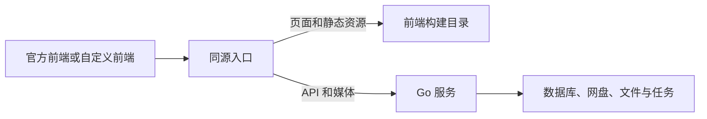

# 自定义前端

前台和管理后台都可以完全重写。Go 服务负责身份认证、权限、数据、任务和媒体访问；页面路由与界面由客户端决定。官方 React 应用位于独立的 `nianzhibai/91-web-nostalgic`（默认）和 `nianzhibai/91-web` 仓库，与独立示例使用同一个无 React 依赖的客户端库。

用户安装并启用前端及命令行维护步骤见 [前端版本与发布](FRONTEND_RELEASES.md)。



## 先运行示例

在仓库根目录执行：

```bash
npm ci
BACKEND_PORT=9191 npm run dev:example
```

先单独启动后端。上述命令假设后端监听本机 9191；打开 `http://localhost:9193`，示例会代理 `/api`、`/admin/api`、`/p`。其他后端端口通过 `BACKEND_PORT` 指定。它支持初始化、登录、搜索分页、原画/HLS 播放、播放源切换、存储列表和管理员主题设置。

示例位于 [`examples/custom-frontend/`](../examples/custom-frontend/)，使用原生 TypeScript，可按自己的需求替换。它演示接入流程；完整管理功能通过 API 和客户端库提供。

```bash
npm run build:example
# 构建产物：examples/custom-frontend/dist/
```

## 发布可安装版本

要让用户在「前端配置」填写仓库链接即可安装，需要按 [前端包协议](FRONTEND_RELEASES.md#前端包协议) 发布 GitHub Release。示例已提供完整流程：

```bash
npm run package:example
# examples/custom-frontend/release/frontend.tar.gz 与 frontend.tar.gz.sha256
```

1. 在 `frontend.json` 中声明名称、版本和 API 范围；每次发布递增 `version`。
2. 以 release 模式构建：资源 `base` 为 `/_frontend/<name>/<version>/`，并把 `frontend.json` 输出到构建目录。见示例的 [`vite.config.ts`](../examples/custom-frontend/vite.config.ts)。
3. 用 [`scripts/package-frontend.sh`](../scripts/package-frontend.sh) 打包，输出目录须在构建目录之外。脚本不依赖本仓库，可复制到自己的前端仓库。
4. 以 `v<version>` 为标签发布两个文件。例如在自己仓库的 GitHub Actions 中：

```bash
bash scripts/package-frontend.sh dist release
gh release create "v$VERSION" release/frontend.tar.gz release/frontend.tar.gz.sha256
```

发布本示例时，两个文件位于 `examples/custom-frontend/release/`。

普通构建不含 `frontend.json` 且使用根路径，适用于下文的 `VIDEO_FRONTEND_DIR` 和独立托管。

前端会同时接管前台和管理页面。若自定义前端不提供「前端配置」页面，用户只能通过 `91 frontend rollback`、`91 frontend reset`（Docker 为 `bash 91-docker.sh frontend ...`）切回。

## 部署

### Go 托管整个前端

设置 `VIDEO_FRONTEND_DIR` 为包含 `index.html` 的构建目录。该目录同时接管前台和管理页面；API、媒体路由保留给 Go 服务。

```bash
cd backend
VIDEO_FRONTEND_DIR=/absolute/path/to/custom/dist ./server
```

未设置目录时，服务查找 `./dist` 和 `../dist`。没有默认目录时，也可通过 CLI 或管理 API 安装并启用前端，无需重启。显式配置的目录缺少 `index.html` 会启动失败。页面深链接回退到当前前端的 `index.html`，缺失的 API 和静态文件返回 404。`/assets/` 下的文件应使用内容哈希命名；页面和其他固定路径资源按内容 ETag 重新验证，支持切换及回滚。

Docker 可创建 `compose.frontend.yml`：

```yaml
services:
  "91":
    environment:
      VIDEO_FRONTEND_DIR: /opt/91/custom-frontend
    volumes:
      - ./custom-dist:/opt/91/custom-frontend:ro
```

```bash
docker compose -f docker-compose.yml -f compose.frontend.yml up -d
```

把这个附加 Compose 文件保留在后续更新使用的 `COMPOSE_FILE` 中。自定义前端放在独立挂载目录，升级镜像不会覆盖它。

### 独立托管前端

后端设置 `VIDEO_FRONTEND_MODE=disabled`，即使存在默认 `dist` 也不会提供页面。默认模式为 `auto`。

前端可独立构建、独立部署。推荐通过反向代理维持浏览器侧同源：

| 请求 | 目标 |
| --- | --- |
| `/api`、`/api/*` | Go 服务，保留路径 |
| `/admin/api`、`/admin/api/*` | Go 服务，保留路径 |
| `/p`、`/p/*` | Go 服务，保留路径 |
| `/peer`、`/peer/*` | 使用服务间备份迁移时转发到 Go |
| 其他页面及静态资源 | 自定义前端 |

反向代理需保留 Cookie、请求方法、Range、ETag、If-Match 和转发信息，允许流式媒体与 SSE，并按上传需求设置正文大小和超时。后端路径不支持额外的子目录前缀。

跨源且同站的部署可配置 `server.allowed_origins` 和客户端 `baseURL`。Cookie 当前为 `SameSite=Lax`；跨站网站直接连接不属于受支持的登录方式，CORS 白名单不会绕过浏览器 Cookie 策略。媒体元素、HLS 请求和 SSE 同样需要会话。官方前端和示例采用同源入口。

## 客户端库

[`sdk/`](../sdk/) 提供 `@91/client`，无运行时依赖，实例之间不共享登录配置或请求状态。可以直接引用源码，也可以构建 npm 安装包：

```bash
npm run build:client
npm pack ./sdk --pack-destination /tmp
# 在自己的前端工程安装生成的 /tmp/91-client-1.0.0.tgz
```

```ts
import { createClient, APIResponseError } from "@91/client";

const client = createClient(); // 默认同源；baseURL 可指定后端的 HTTP(S) origin
const info = await client.server();
if (!info.apiVersion.startsWith("1.")) throw new Error("需要 API v1");

await client.auth.login(username, password);
const { items } = await client.videos.fetchListing(1, 12, { q: "搜索词" });
const playback = await client.playback.get(items[0].id);
const source = playback.sources.find(source => source.status === "ready");
if (source?.url) video.src = client.resourceURL(source.url);

// 后端会验证管理员身份。
await client.admin.updateSettings({ theme: "light" });
```

`client.auth` 提供初始化和会话接口，`client.videos` 提供视频、feed、标签、互动、分享和上传，`client.admin` 提供管理方法及数据类型，`client.playback` 提供播放源获取、解析和准备。也可以用 `client.http.request<T>(path, init)` 调用完整 HTTP 契约中的任意接口。

前端收到资源路径后用 `client.resourceURL(path)` 解析；同源媒体请求继续使用 Cookie。独立前端自行生成详情页、管理页路由。`href`、格式化 `duration` 和分享 `url` 是官方前端的便利字段；业务计算用 `durationSeconds`，自定义分享页用返回的 `token` 构建 URL fragment，然后 POST 到分享领取接口。

普通 JSON 请求错误抛出 `APIResponseError`，包含 `status`、可用时的 `code` 和原始 `body`；401 是其子类 `UnauthorizedError`。配置版本冲突为 `ConfigConflictError`。服务故障与未登录应分别处理。SDK 不替你跳转页面或修改主题、DOM、localStorage。Node 环境需要自己注入管理 Cookie 的 `fetch`。

## 接口契约与流程

`GET /api/server` 返回应用版本、API 版本和入口；`GET /api/openapi.json` 提供 OpenAPI 3.1 文档。源文件为 [`openapi.json`](../backend/internal/api/openapi.json)，测试覆盖路由、SDK 列表及日志请求参数、核心响应 DTO 的字段、类型与可选性。服务间 `/peer` 协议使用单独的接收令牌，不属于浏览器管理会话接口。

当前契约版本为 `1.0.0`，由 [`httpapi.Version`](../backend/internal/httpapi/version.go) 定义，独立于前端包版本。认证入口为 `/api/auth/*`，视频和设置为 `/api/*`，管理为 `/admin/api/*`，媒体为 `/p/*`。保留的 `/admin/api/login` 等旧认证入口已标记弃用。破坏性契约变化需要更新 API 主版本、文档及 SDK；新增可选字段不要求客户端升级。

| 流程 | 约定 |
| --- | --- |
| 初始化 | GET `/api/auth/setup`；仅首次允许 POST 创建管理员，成功后已建立会话 |
| 登录 | POST `/api/auth/login`，浏览器保存 HttpOnly Cookie；GET `/api/auth/me` 查询身份，POST `/api/auth/logout` 撤销会话 |
| 权限 | 普通用户接口也需要登录；管理操作由服务端检查角色。401 为缺少有效会话，403 为权限不足 |
| 列表 | `page` 从 1 开始。feed 首次指定 `kind=listing/recommend/latest`、空 token、cursor=0，之后沿用 token 和返回游标；410 时重新建立 feed |
| 播放 | 获取 sources；`unknown` 通过 `resolveUrl` 解析；`processing` 根据用户选择 POST `prepareUrl`，随后轮询。离开播放器时停止请求，过期地址重新解析 |
| 媒体 | `file` 支持浏览器文件播放，`hls` 使用原生 HLS 或 hls.js。后端可能代理或跳转上游；不要把管理凭据附加到第三方媒体 URL |
| 配置 | GET YAML 并保存 ETag；PUT 时带 If-Match。409 时重新读取并让用户处理冲突，避免自动覆盖 |
| 后台任务 | 接受请求与任务完成分开处理；读取对应状态，按允许的操作取消。创建、上传、准备转码等写操作不能自动重试 |
| 实时状态 | 网盘 `/events` 使用 SSE，支持 `snapshot`、`heartbeat`；离开页面时关闭连接 |
| 备份 | 下载和分块上传使用二进制；恢复前需要明确确认，202 表示已接受，后续可能重启 |

维护时同步修改契约和 SDK；后端仓库运行 `npm run check`、`npm run build:client`、`npm run build:example`、`npm run package:example` 与 `cd backend && go test ./...`。前端仓库单独运行 `npm run check` 和 `npm run package`。
