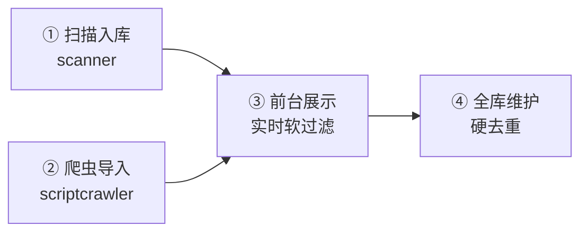
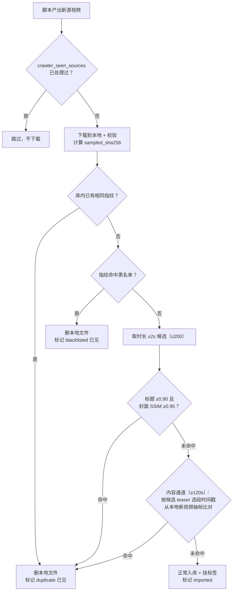
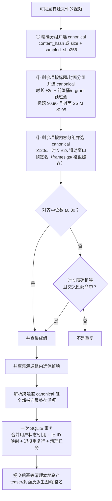

# 去重体系

去重分布在扫描入库、爬虫导入、前台软过滤和全库维护四个时机。哈希或采样指纹用于匹配字节证据，标题、封面与 teaser 内容帧用于匹配转码副本。扫描和软过滤还使用 `file_name + size_bytes` 弱兜底；双方都有采样指纹，或同盘双方都有原生哈希时，这些信号必须一致，弱兜底才成立。

以下路径均相对 `backend/`：`internal/scanner/`（扫描）、`internal/drives/scriptcrawler/neardupe.go`（爬虫）、`internal/dedupe/`（规划）、`internal/catalog/`（软过滤、墓碑与事务）、`cmd/server/video_maintenance.go` 和 `video_dedupe_plan.go`（维护执行）、`internal/mediasim/`（相似度与阈值）。

## 判定信号

| 信号 | 是什么 | 能抓住什么 | 抓不住什么 |
|------|--------|-----------|-----------|
| `(drive_id, file_id)` | 视频恒等 ID | 同盘同文件的重复扫描（upsert 同一行） | 一切副本 |
| `content_hash` | 网盘原生哈希（如 115 SHA1、PikPak GCID） | 原生哈希值相同的文件，可跨盘匹配 | 不同算法产生不同哈希值的副本、转码副本 |
| `sampled_sha256` | `size + 采样字节` 的统一指纹，fingerprint worker 后台计算 | **跨盘**字节采样一致的文件 | 转码/水印副本 |
| `file_name + size_bytes` | 精确信号缺失时的弱兜底；双方可比较的指纹或同盘哈希不同时不成立 | 常见的同名同大小副本 | 改名副本；指纹算出前仍可能碰撞不同内容 |
| 标题相似度 + 封面 SSIM | 归一化 Levenshtein（含核心段变体）+ 96×96 亮度 SSIM | 同源重发（标题几乎一样） | 改名重发、跨源转码 |
| teaser 帧签名 | teaser 按 1fps 抽 12 帧 96×96 灰度 | **跨源不同压制**（标题、封面全对不上也能抓） | 时长差 >2 秒的剪辑版 |

预览的**选段起点只由时长决定**，分档策略见 [README「异步生成」](../backend/README.md#异步生成)。时长接近的视频在 teaser 相同偏移处通常对应同一源画面，因此可比较不同压制、水印或裁切版本。

内容级判定规则，阈值常量统一在 `mediasim`：

| 规则 | 条件 | 结论 |
|------|------|------|
| 对齐 | 对齐帧 SSIM 中位数 ≥0.80 | 重复，自动处理 |
| 交叉兜底 | 对齐未命中、**时长精确相等**时：双方各至少 8 个有效帧，双向逐帧最优匹配，单帧 ≥0.95、双向 ≥75% 帧强匹配 | 重复（teaser 某段回退到备选起点造成整段错位的场景） |

亮度标准差 <6 的纯色/黑场帧不参与统计；有效比较帧少于 6 不判重；时长不足 120 秒不启用内容通道，避免短视频时长碰撞。

## 四个时机

**① 扫描入库（`internal/scanner`）**——同 `(drive_id, file_id)` 重复扫描只 upsert 同一行；黑名单（`deleted_videos`）拦截被拉黑的源文件本身，以及任意网盘上原生哈希相同、或同盘文件名加大小相同的新文件，详见[用户删除](#用户删除)；它只拦截新入库，库内仍绑定该网盘文件的视频照常更新。原生哈希相同，或采样指纹和大小均相同，即命中精确规则。文件名和大小用于弱兜底。文件大小或已知哈希变化时，扫描会清除旧指纹、封面和预览并安排重新生成。无法用哈希比较时，扫描参考源文件的修改时间：第一次取得的修改时间只作为基准记录；之后修改时间变化，扫描先保留封面和预览，把旧采样指纹留作对照并重新计算。新指纹相同则只更新修改时间；不同则清除封面、预览和原生哈希并重新生成。没有旧指纹可对照的记录直接重新生成。核对完成前，该视频不参与标题/封面和内容通道的判重。

网盘列出了视频但报告的大小为 0 或负数时，扫描将文件计为已看到。新文件等到大小有效时再入库。已入库的视频暂时退出展示和判重，保留原 ID、观看记录和已有预览。后续扫描取得正数大小时，按正常的内容变化规则更新并恢复展示。这个临时状态不会进入黑名单。旧版本已写入黑名单的记录需要在后台恢复。

**② 爬虫导入（`internal/drives/scriptcrawler`）**——层层拦截，重复视频在**上传网盘之前**就被挡下：

标记过 `crawler_seen_sources` 的源永远不会再下载，即使对应视频后来被夜间维护删掉——这保证"删重复"不会引起"再爬回来"的循环。

爬虫始终保留已入库的视频，即使新下载的副本更大。命中后，Catalog 在同一个事务中记录判重依据和爬虫已见状态。

**③ 前台展示（实时软过滤）**——`content_hash`、`size_bytes + sampled_sha256` 或弱兜底 `file_name + size_bytes` 相同的视频，前台列表和封面/预览生成队列在可见且有源文件的记录中选择最早入库的那条（`uniqueVideoWhereSQL`）。行还在库里，作用是在夜间硬去重跑到之前不给用户看重复、不给副本白白生成资产。

**④ 全库维护（`internal/dedupe` + `cmd/server/video_maintenance.go`）**——定时维护和后台「扫描所有网盘」最终都会执行。Planner 只读计算完整计划，三个通道串行，前一通道的逻辑删除项不进下一通道：

每个通道都从该通道形成的重复组内部选择 canonical，而不是从全库另找视频。精确通道按 **本地资产完整度 > 入库早**；标题/封面与内容通道按 **体积大 > 资产完整度 > 入库早**——优先留原版画质。重复关系按传递闭包成组：A 命中 B、B 命中 C 时，A/B/C 属于同一个重复组。

Planner 跑完全部通道后会压缩 canonical 链。例如精确通道先得到 `B → A`，内容通道又得到 `A → C`，最终事务写成 `B → C`、`A → C`，不会留下指向中间删除项的引用。

提交前会校验删除项和最终 canonical 的视频修订；规划期间若来源、匹配信号或资产版本发生变化，整个事务回滚并基于最新数据重新规划（最多三次），观看和点赞计数变化不影响计划。

合并语义（所有通道一致）：先把重复项的标签、访问反应、观看/点赞等计数、分享和历史任务引用合并到最终保留项，再把旧公开 ID、保留项 ID 和来源快照写入 `merged_videos`，退役重复行。旧链接解析到当前保留项，连续合并会更新已有映射。原网盘文件保留，扫描根据来源快照和保留项判断是否继续跳过。文件被替换后重新走入库判定，原 ID 仍属于原视频。自动合并只增加已合并记录；黑名单列表和清理任务只接收用户主动屏蔽的来源。事务同时登记 `duplicate_asset_cleanup_jobs`，提交后幂等清理本地 teaser、普通封面、Shorts 背景封面和帧签名缓存；进程中断或文件系统临时失败时由下一轮维护重试。

## 已合并视频管理 API

管理员调用 `GET /admin/api/merged-videos` 分页查询（`page`、`size`，可按 `canonicalVideoId`、`driveId`、`sourceState` 筛选）。`GET /admin/api/merged-videos/{id}` 按副本原 ID 返回来源快照、`sourceRevision` 及当前是否有活动视频共用源文件。来源状态 `recorded` 表示已记录，`gone` 表示确认消失，`replaced` 表示该位置的文件已经改变。

`DELETE /admin/api/merged-videos/{id}/source` 接收 `{"sourceRevision":"…"}`。核对来源后删除物理文件，保留旧 ID 映射；同一版本重试返回成功。缺少版本返回 400，未知 ID 返回 404。版本过期、共享源文件、文件被替换、身份无法核实或另一次删除正在执行，返回 409 和具体错误码。管理统计 `GET /admin/api/videos/stats` 的 `merged` 按已合并的原 ID 计数。

## 用户删除

前台“不再展示”和后台“仅删除记录”会把整组视频加入黑名单，保留网盘文件。分组沿共享源文件和库内已有的判重关系查找，涵盖跨盘副本、维护已合并的副本、扫描时记下并跳过的文件，以及因网盘暂时报告大小无效而退出展示的精确副本。

黑名单按内容拦截。每条记录保存原生哈希和采样指纹，`blocks_content = 1` 时拦截相同内容的新视频：

| 时机 | 拦截条件 |
|------|----------|
| 扫描入库 | 原生哈希相同（任意网盘），或同盘文件名加大小相同且指纹、哈希不冲突 |
| 采样指纹算出时 | 指纹加大小或原生哈希相同，且库内没有可见的同内容视频；该视频转入黑名单，`reason` 为 `blacklisted_content` |
| 爬虫导入 | 下载后指纹加大小相同；来源标记为 `blacklisted`，不再下载 |

库内已有可见的同内容视频时，新文件按普通重复处理。恢复黑名单中的任一视频时，同内容记录的 `blocks_content` 置为 0：它们各自的源文件仍被拦截，同内容的新文件改与恢复的视频按普通规则判重。再次拉黑会重新启用拦截。

源文件被删除后，黑名单记录仍然保留并继续拦截相同内容，`sourceDeleted` 为 `true`。这类记录不再匹配原文件 ID，网盘复用该 ID 存放其他内容时按新文件处理。源文件已删除，移出黑名单只解除内容拦截，不恢复视频，`restorePolicy` 为 `scan`。旧版本删除源文件时清除了黑名单记录，这些内容不会补回拦截。

后台勾选删除源文件时，先调用 `GET /admin/api/videos/{id}/deletion-preview`。成功返回 `200`，包含独立源文件列表 `sources`、版本 `groupRevision` 和 `requiresConfirmation`。列表首项是选中视频的文件。多条记录共用一个文件时只列一项，可携带预览版本直接提交删除。

物理删除与只删记录使用同一个删除组，即前台同一张卡片内的全部视频，包括只靠文件名加大小关联的视频，另加合并记录和扫描跳过记录对应的源文件。

如果 `requiresConfirmation` 为 `true`，前端询问是否一并删除重复文件。用户确认后调用 `DELETE /admin/api/videos/{id}`，提交 `deleteSource: true`、预览的 `groupRevision` 和 `includeDuplicates`。选择 `true` 删除全部文件，并把整组视频以源文件已删除的状态加入黑名单；选择 `false` 只删除当前文件及其引用记录，组内其他视频仍保留这份内容，因此不加入黑名单。用户取消即可关闭弹窗。删除成功返回 `200`。预览后范围变化时返回 `409 deletion_scope_changed`，前端重新获取预览。

只删除当前文件时，合并到被删视频的副本交给组内最早入库的可见视频，旧 ID 解析到它，扫描继续跳过这些副本。没有可见视频保留时，释放仍在原位的副本，下次扫描以原 ID 入库。

跨盘删除逐个完成，用户选中的文件最后处理。某个网盘失败时可以从原视频重新发起请求。扫描历史中的源文件在物理删除前会向网盘核对当前信息。

## 缓存与工具

- 帧签名按 `(teaser size, mtime)` 缓存在 `previews/framesigs/`，预览更新后失效，视频删除时清理；全库维护和爬虫内容通道共用缓存。
- 在 `backend/` 执行 `go run ./cmd/dedupe-dryrun` 默认仅预演内容通道，不合并视频或删除资产；工具打开数据库时仍可能执行 schema 初始化或迁移。通过 `-db` / `-local-dir` 指定数据库与预览目录；加 `-apply` 提交计划，沿用维护的合并事务和资产清理路径。
- 重复决策的 SQL 查询、证据和备份规则见 [内部记录](../backend/internal/dedupe/RECORDS.md)。
