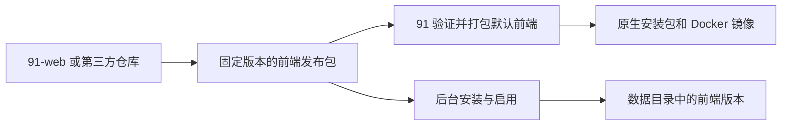

# 前端版本与发布

`91` 维护后端、API 契约、SDK和整套产品发布；`nianzhibai/91-web` 维护官方视频前台、管理界面与前端构建。



## 用户更换前端

进入「配置面板 → 前端版本」，填写 GitHub `owner/name` 和明确的版本标签。安装完成后选择启用，也可回到上一版本或恢复随当前服务提供的默认前端。切换后重新打开首页，无需重启后端。

原生安装提供同一组操作：

```bash
91 frontend status
91 frontend install --repository nianzhibai/91-web --version v1.0.0
91 frontend install --package /absolute/path/frontend.tar.gz --sha256 <SHA256>
91 frontend activate --id 91-web@1.0.0
91 frontend rollback
91 frontend reset
```

命令行 `install` 安装并启用；管理 API 的安装和启用是两个操作。安装包只包含静态页面，不会执行安装脚本。

Docker 用户在 Compose 目录运行：

```bash
bash 91-docker.sh frontend status
bash 91-docker.sh frontend install --repository nianzhibai/91-web --version v1.0.0
bash 91-docker.sh frontend rollback
bash 91-docker.sh frontend reset
```

Docker 中 `--package` 指容器内可读取的文件路径。也可以直接运行 `docker compose exec -T 91 docker-entrypoint.sh ./server frontend ...`。

前端文件和启用记录存放在 `storage.data_dir/frontends/`，因此现有 Docker 数据挂载即可持久保存。应用升级不覆盖自定义版本。切换前验证 API 兼容范围，拒绝同名同版本但内容不同的安装；旧资源保留供已有页面和回滚使用。暂不自动删除历史版本，也不自动追踪 `latest`。

管理 API：`GET /admin/api/frontend`、`POST /install`、`PUT /active`、`POST /rollback`、`POST /reset`（后四个路径以 `/admin/api/frontend` 开头），均需要管理员会话。

## 前端包协议

GitHub Release 必须同时提供 `frontend.tar.gz` 与 `frontend.tar.gz.sha256`。校验文件使用 `SHA256  frontend.tar.gz` 格式。仅支持固定 `vX.Y.Z` 标签。

压缩包根目录的 `frontend.json`：

```json
{
  "formatVersion": 1,
  "name": "91-web",
  "version": "1.0.0",
  "apiMin": "1.0.0",
  "apiMaxExclusive": "2.0.0"
}
```

名称使用小写字母、数字和连字符；API 范围为左闭右开。构建资源路径使用 `/_frontend/<name>/<version>/`，页面路由和 API 路径不加此前缀。Vite 可以通过 `base` 配置实现。压缩包只能包含普通文件和目录，不接受符号链接、路径穿越和重复条目。

## 产品打包

`frontend.lock.json` 固定官方前端仓库、名称、版本和归档 SHA-256。先发布 `91-web`，再更新此锁文件并发布 `91`。构建辅助程序会验证摘要、清单身份及 API 范围；下载失败会中止打包，不替换现有页面。

```bash
# 新目录；不会覆盖正在使用的 dist
bash scripts/prepare-frontend.sh /tmp/91-frontend-build

# 离线或前端尚未发布时，使用已构建且与锁文件一致的归档
FRONTEND_ARCHIVE=/path/frontend.tar.gz bash scripts/prepare-frontend.sh /tmp/91-frontend-build
FRONTEND_ARCHIVE=/path/frontend.tar.gz bash scripts/build-release.sh
```

Docker 离线构建可把同一归档放入被 Git 忽略的 `frontend-bundle/frontend.tar.gz`，随后正常 `docker build`；锁文件校验始终生效。正式安装包和镜像携带默认前端，服务器首次启动无需联网下载。

原有 `VIDEO_FRONTEND_DIR` 继续指定默认静态目录，`VIDEO_FRONTEND_MODE=disabled` 关闭页面托管。使用版本管理时通常无需修改这些环境变量。
