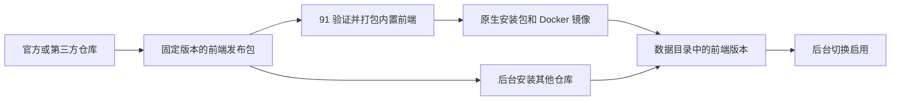

# 前端版本与发布

`91` 维护后端、API 契约、SDK和整套产品发布。官方前端有两个独立仓库，各自包含视频前台、管理界面与前端构建：

| 仓库 | 说明 |
| --- | --- |
| `nianzhibai/91-web-nostalgic` | 默认前端 |
| `nianzhibai/91-web` | 新版界面，仍在完善 |

两者都随安装包和镜像内置，可在后台直接切换，无需联网。



## 用户更换前端

进入「配置面板 → 前端配置」，点选本地可用的前端，或填写完整 GitHub 仓库链接（例如 `https://github.com/nianzhibai/91-web`），然后保存配置。按钮随仓库变化，操作完成后自动打开首页，无需重启后端：

| 仓库状态 | 按钮 | 行为 |
| --- | --- | --- |
| 已安装（包括内置前端），但未启用 | 启用 | 启用本地最新的兼容版本，不联网 |
| 未安装 | 安装并启用 | 下载该仓库的最新正式发布 |
| 正在使用 | 检查更新 | 只读取最新发布信息；有新版时显示「更新并启用」，否则提示「已是最新版本」 |

页面不显示历史版本列表。

仓库地址保存在 `config.yaml` 的 `frontend.repository`，新安装默认为 `91-web-nostalgic`，可视化与源码编辑共用同一份配置。保存地址不会下载或切换前端；点击按钮时才执行。

原生命令行还提供固定版本和离线维护操作：

```bash
91 frontend status
91 frontend install --repository nianzhibai/91-web --version v1.0.0
91 frontend install --package /absolute/path/frontend.tar.gz --sha256 <SHA256>
91 frontend activate --id 91-web@1.0.0
91 frontend rollback
91 frontend reset
```

命令行和管理 API 的 `install` 都会安装并启用。安装包只包含静态页面，不会执行安装脚本。

Docker 用户在 Compose 目录运行：

```bash
bash 91-docker.sh frontend status
bash 91-docker.sh frontend install --repository nianzhibai/91-web --version v1.0.0
bash 91-docker.sh frontend rollback
bash 91-docker.sh frontend reset
```

Docker 中 `--package` 指容器内可读取的文件路径。也可以直接运行 `docker compose exec -T 91 docker-entrypoint.sh ./server frontend ...`。

前端文件和启用记录存放在 `storage.data_dir/frontends/`，因此现有 Docker 数据挂载即可持久保存。应用升级不覆盖自定义版本。切换前验证 API 兼容范围，拒绝同名同版本但内容不同的安装；旧资源保留供已有页面和回滚使用。暂不自动删除历史版本，也不会定时自动更新。

管理 API：`GET /admin/api/frontend` 读取状态和当前仓库，`GET /admin/api/frontend/update` 检查更新（不下载或安装），`POST /admin/api/frontend/install` 启用已保存的仓库：其他仓库已安装时直接启用本地版本，否则安装并启用最新发布（无请求体），均需要管理员会话。独立启用、回滚和恢复默认的管理接口已移除。

## 前端包协议

GitHub Release 必须同时提供 `frontend.tar.gz` 与 `frontend.tar.gz.sha256`。校验文件使用 `SHA256  frontend.tar.gz` 格式。发布标签使用 `vX.Y.Z`；面板自动解析最新正式发布，并校验包内版本与标签一致。

压缩包根目录的 `frontend.json`：

```json
{
  "formatVersion": 1,
  "name": "91-web",
  "version": "1.0.0",
  "apiMin": "1.0.0",
  "apiMaxExclusive": "2.0.0"
}
```

名称使用小写字母、数字和连字符；API 范围为左闭右开。构建资源路径使用 `/_frontend/<name>/<version>/`，页面路由和 API 路径不加此前缀。Vite 可以通过 `base` 配置实现。压缩包只能包含普通文件和目录，不接受符号链接、路径穿越和重复条目。

## 产品打包

`frontend.lock.json` 列出全部内置前端的仓库、名称、版本和归档 SHA-256，`default` 指定首次启动使用的前端。先发布前端，再更新此锁文件并发布 `91`。构建辅助程序会逐个验证摘要、清单身份及 API 范围；任一失败都会中止打包，不替换现有页面。

```json
{
  "default": "91-web-nostalgic",
  "frontends": [
    { "repository": "https://github.com/nianzhibai/91-web-nostalgic", "name": "91-web-nostalgic", "version": "v1.0.0", "sha256": "…" },
    { "repository": "https://github.com/nianzhibai/91-web", "name": "91-web", "version": "v1.0.0", "sha256": "…" }
  ]
}
```

打包结果（安装包和镜像中的 `dist/`）是一个前端包目录，结构与数据目录中的前端版本相同：

```text
dist/
  bundle.json                       # {"formatVersion": 1, "default": "<name>@<version>"}
  releases/<name>@<version>/
    release.json                    # 来源仓库、归档摘要和内容摘要
    site/                           # 静态页面
```

服务启动时校验每个内置前端的内容摘要，并连同来源仓库复制到 `storage.data_dir/frontends/`，所以后台可以离线切换。未选择其他前端时使用 `default`。

CI 和正式发布流程先用 `gh release download` 下载一次锁定版本的前端归档，验证通过后保存为工作流 artifact。各架构 Docker 构建和 Linux 安装包复用这些归档，并在打包时继续校验；准备失败会阻止后续构建。

```bash
# 新目录；不会覆盖正在使用的 dist
bash scripts/prepare-frontend.sh /tmp/91-frontend-build

# 离线构建：目录中为锁文件里每个前端放入 <name>.tar.gz，且与锁文件一致
FRONTEND_ARCHIVES=/path/archives bash scripts/prepare-frontend.sh /tmp/91-frontend-build
FRONTEND_ARCHIVES=/path/archives bash scripts/build-release.sh
```

Docker 离线构建可把同样命名的归档放入被 Git 忽略的 `frontend-bundle/`，随后正常 `docker build`；锁文件校验始终生效。正式安装包和镜像携带全部内置前端，服务器首次启动无需联网下载。

`VIDEO_FRONTEND_DIR` 指定前端包目录或单个静态页面目录（含 `index.html`），后者用于开发和自托管自定义前端；`VIDEO_FRONTEND_MODE=disabled` 关闭页面托管。使用版本管理时通常无需修改这些环境变量。
