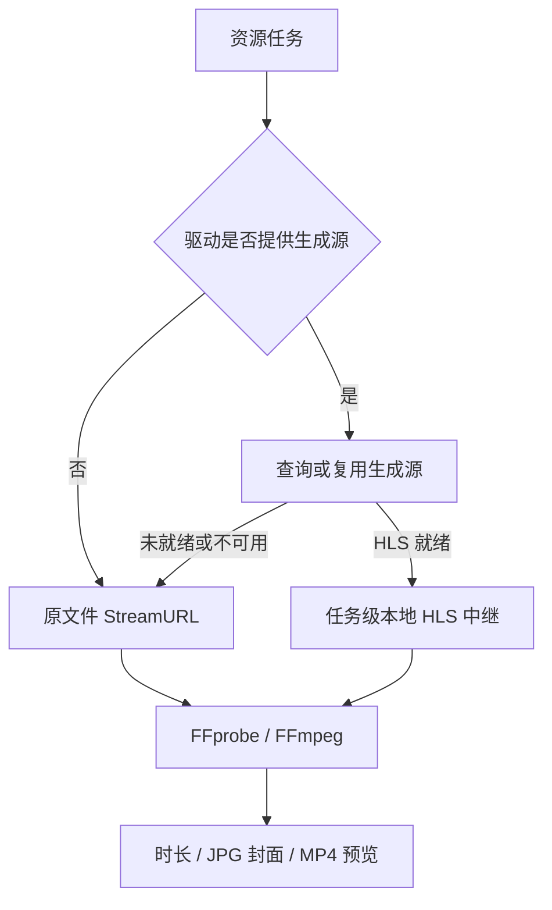

# 视频资源生成

## 调度

每个来源（网盘、站内上传、Telegram 本地盘、爬虫目录）有一个运行器，内含两条通道，待办只记在数据库里。上传、扫盘、爬虫入库、重新生成和重试只改库并唤醒对应来源；通道空闲时每分钟也会自查一次。

```mermaid
flowchart LR
    W[唤醒或定时自查] --> F
    W --> A
    subgraph 指纹通道 不占名额
        F[取待算指纹的视频] --> F2[等冷却结束<br/>计算采样指纹]
    end
    subgraph 资源通道 最多同时处理来源上限个视频，每个占一个名额
        A[取指纹已结清的视频] --> A2[等冷却结束、取名额<br/>媒体任务 → 封面 → 时长]
    end
    F2 -->|唤醒| A
```

- **两条通道**：指纹通道只读几 MiB，不解码，不占名额；资源通道跑媒体任务、封面和时长，只取指纹已结清（算出、失败或无法计算）的视频，所以判为重复的视频不会进入解码。指纹通道一次一个视频，资源通道同时处理的视频数不超过来源上限，同一视频不会同时被处理两次；每算完一个指纹就唤醒资源通道，新视频的封面不必等全盘指纹算完。
- **名额**：`generation.concurrency`（1-5，默认 1，热更新）是全部来源同时跑资源通道的视频数，代表本机解码能力。空出的名额优先给当前占用最少的来源，同等占用时先到先得，所以本地来源能在空闲时用满名额，又不会让云盘排在它的长队后面。冷却中的来源不占名额。指纹计算都不占名额，包括爬虫导入和拉黑校验时的单次计算。
- **来源上限**：代表来源能承受的并发读取。云盘默认 1，避免触发风控；本地来源（站内上传、Telegram 本地盘、本地目录、爬虫目录）默认只受全局名额限制。`POST /admin/api/drives/{id}/generation-parallelism` 可为单个网盘设置 0-5（0 为默认，存于 `drives.generation_parallelism`），立即生效：正在处理的视频照常完成，之后按新上限取视频。实际上限不超过全局名额。
- **顺序**：指纹按入库时间；资源先取媒体任务，再取缺封面、缺时长的视频，同级按入库时间。每个步骤执行前重新读取该行，源文件被替换、指纹重新到期时，资源步骤立即停下，等指纹重算。
- **推迟**：一条通道的步骤跑完、该通道仍有到期工作且来源未冷却（例如时长探测失败）时写入 `generation_after`，6 小时内不再取该视频；扫盘、手动重试、重新生成和源文件变化会解除推迟，打开预览会解除待生成预览的视频的推迟。步骤读取源文件失败时直接结束该视频本轮，后续步骤不再重复取链，交给推迟。同一视频同一时刻只在一条通道里有到期工作，推迟不会拖住另一条。
- **到期查询**：指纹、资源和预览各有一个部分索引，只收录可能有待办的视频；到期列表和计数只经这些索引读取，耗时随待办数而不是盘的大小增长。预览单独建索引，因为预览关闭期间新视频的预览一直待生成。
- **停止与切换配置**：「停止任务」中断两条通道正在处理的全部视频并暂停该来源，待办留在库里，下次唤醒继续。配置变更等待来源空闲后生效；重新挂载会替换运行器，旧运行器不再接新视频。
- **等待**：爬虫在转存前、夜间维护在去重前等待来源空闲，即两条通道都没有到期工作且没有视频在处理。

代码入口：[运行器](../backend/internal/generation/runner.go)、[到期查询](../backend/internal/catalog/generation_work.go)、[接线](../backend/cmd/server/generation.go)。

## 取流

封面、预览视频和缺失时长补全共用 `GenerationStreamProvider`。支持的网盘自动优先使用就绪的云端 HLS；其他驱动使用 `StreamURL`，无需额外配置。

| 网盘 | HLS 来源 | 生成策略 |
| --- | --- | --- |
| 115 | 在线播放主清单 | 沿用最高带宽子清单及现有缓存、扫描重置机制 |
| 夸克 | `/file/v2/play` | 按清晰度从高到低选择就绪的 HLS；每次媒体请求读取最新 Cookie |
| 联通 | `VideoDisplayFiles` | 使用匹配文件的 `m3u8` |
| 移动 | `/videoPreview/getPreviewInfo` | 仅使用 `Finished` 且地址有效的源 |

生成只消费就绪源，不轮询转码，也不额外调用转码准备接口。夸克使用现有播放查询端点，其服务端是否隐式启动准备由上游决定。



### 生命周期与恢复

- 生成与在线播放独立缓存。夸克、联通、移动按挂载驱动和文件合并并发取链，成功缓存最多两分钟且不超过链接期限；不可用结果按文件缓存 30 秒。强制刷新不复用旧的普通取链请求。
- HLS 清单、子清单、分片、初始化片段和密钥统一经过任务的本地中继。账号头留在 Go 进程内；需要账号鉴权的请求和重定向必须符合驱动的主机策略。
- 时长探测与资源生成共用一次刷新预算。签名拒绝可刷新一次：115、联通、移动为 403，夸克为 403/412。仍失败或解码失败时回退原文件。
- 中继遇到上游拒绝时取消当前源的媒体命令及在途请求，并阻止后续取流；真实错误在命令结束时传回，先于换片段或硬件回退。外层任务仍可刷新或切换原文件。
- 明确的 405/429 限流保留状态及 `Retry-After`，进入现有任务冷却机制；账号失效和任务取消不触发原文件回退。没有探测出时长不视为 HLS 故障，继续使用未知时长的生成策略。
- 任务结束、切换源或取消时关闭中继。文件指纹仍读取原文件字节。

代码入口：[生成接口](../backend/internal/drives/iface.go)、[生成源缓存](../backend/internal/generationsource/cache.go)、[任务恢复](../backend/internal/preview/generation_source.go)、[HLS 中继](../backend/internal/hlsrelay/loopback.go)。
