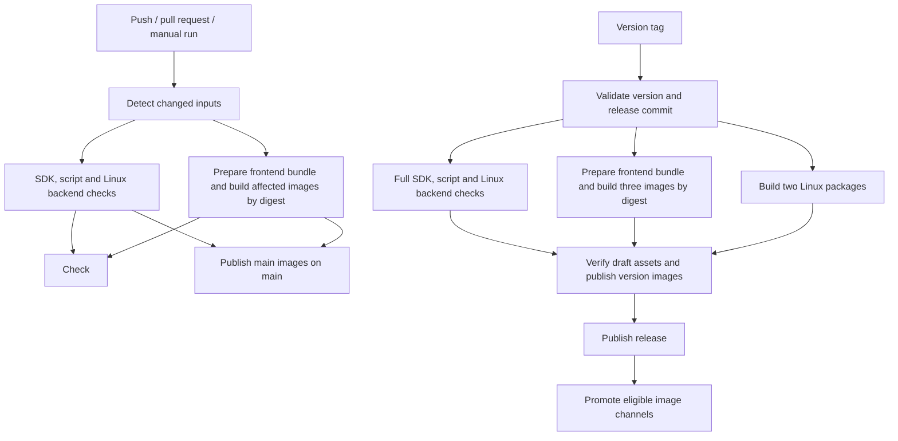

# Workflows

`ci.yml` handles pull requests, pushes to `main`, and manual checks. `release.yml`
handles version tags. Both call `checks.yml`, `prepare-frontend.yml`, and
`docker-build.yml` from the same commit. Configure branch protection to require
the CI job named **Check**.

Supporting maintenance workflows:
- `audit.yml` runs `npm run audit` weekly, manually, and on pull requests that
  touch Node dependency files, without blocking unrelated changes or urgent
  releases.
- `cleanup-ghcr.yml` prunes unreferenced untagged images and stale `sha-*` tags
  from GHCR weekly after inspecting every surviving tagged manifest.

Tests and builds run in parallel; nothing is published until both succeed.

- Pull requests compare against their base. Pushes compare against the last
  successful CI run on the branch, so changes from replaced or failed runs
  still reach the published images. Rerunning the already-succeeded commit
  (`base === head`) falls back to running everything.
- Documentation-only changes (including `ReadMeImage/`) skip tests and image
  builds. Test-only, SDK, custom-frontend example, and Node tooling changes run
  `checks.yml` without rebuilding images. Backend changes also run Node tests
  because some assertions inspect Go source. Deployment scripts, workflows, and
  unknown inputs run everything. Missing diff information also runs everything.
- Tags and manual runs always run all checks. Failed or canceled jobs cannot
  pass `Check`; skips are accepted only when change detection permits them.
- Superseded pull request runs are canceled. Runs on `main` are never canceled
  mid-publication; newer pushes wait.
- Docker builds run on two native runners (`amd64` and `arm64`), with the
  `arm64` runner building both standard and Rockchip variants sequentially to
  reuse the warm local BuildKit cache. Only pushing runs (`main` and releases)
  write to the GitHub Actions Docker cache.
- Images are pushed by digest before checks finish, but tags are only applied
  after checks pass. Failed runs leave untagged image versions in GHCR until
  `cleanup-ghcr.yml` prunes unreferenced versions.
- Release tags use `vMAJOR.MINOR.PATCH` or `vMAJOR.MINOR.PATCH-prerelease`
  and must point to a commit on the default branch.
  Prereleases publish version tags only. Stable releases may advance their
  major/minor channels and `latest`/`stable`, but never replace newer versions.
- Release runs are serialized across tags. CI build artifacts are retained for
  7 days, release artifacts for 30 days, and failure logs for 14 days.
- New releases stay drafts until archive checksums and version images are ready.
  Retrying a draft resumes publication. Retrying a public release reuses its
  verified assets and version images instead of overwriting downloads. A moved
  tag or mismatched release commit fails publication.
- GitHub Releases and GHCR are separate services, so publication is not one
  transaction. A failure during channel promotion is recovered by rerunning the
  failed publish job; already published version artifacts remain usable.

Local validation: `npm run verify`, `npm run audit`, `cd backend && go vet ./... && go test -count=1 -timeout=15m ./...`,
and `shellcheck .github/scripts/publish-images.sh scripts/build-release.sh scripts/prepare-frontend.sh`.
The backend suite requires FFmpeg and Python; tests requiring live credentials or GPU hardware remain opt-in.
The standalone `scripts/build-release.sh` continues to verify and build packages.
