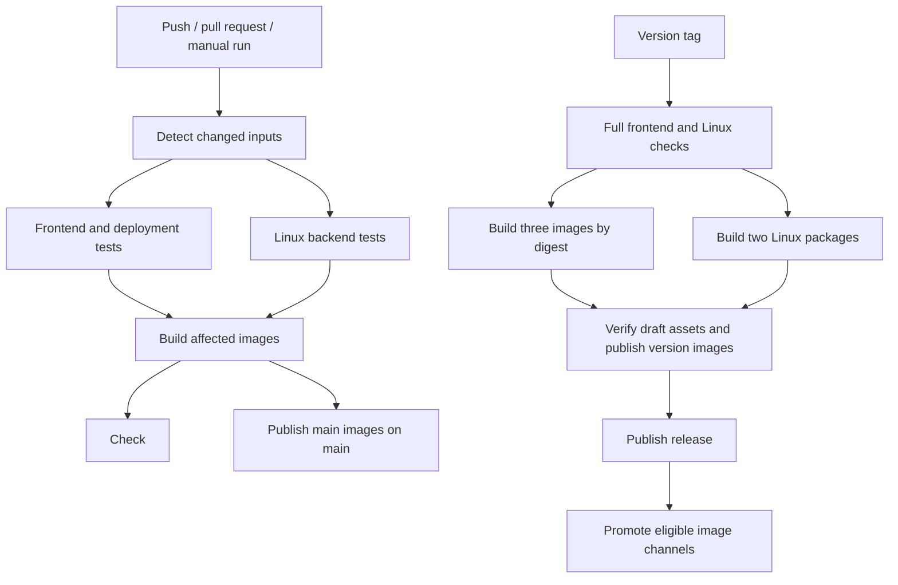

# Workflows

`ci.yml` handles pull requests, pushes to `main`, and manual checks. `release.yml`
handles version tags. Both call `checks.yml` and `docker-build.yml` from the same
commit. Configure branch protection to require the CI job named **Check**.

- Documentation-only changes skip tests and image builds. Test-only changes run
  checks without rebuilding images. Backend changes also run Node tests because
  some assertions inspect Go source. Deployment scripts, workflows, and unknown
  inputs run everything. Missing diff information also runs everything.
- Tags and manual runs always run all checks. Failed or canceled jobs cannot
  pass `Check`; skips are accepted only when change detection permits them.
- Release tags use `vMAJOR.MINOR.PATCH` or `vMAJOR.MINOR.PATCH-prerelease`
  and must point to a commit on the default branch.
  Prereleases publish version tags only. Stable releases may advance their
  major/minor channels and `latest`/`stable`, but never replace newer versions.
- Release runs are serialized across tags. Packages and image digests remain
  available for 30 days; failure logs are retained for 14 days.
- New releases stay drafts until archive checksums and version images are ready.
  Retrying a draft resumes publication. Retrying a public release reuses its
  verified assets and version images instead of overwriting downloads. A moved
  tag or mismatched release commit fails publication.
- GitHub Releases and GHCR are separate services, so publication is not one
  transaction. A failure during channel promotion is recovered by rerunning the
  failed publish job; already published version artifacts remain usable.

Local validation: `npm run check`, `cd backend && go test -count=1 -timeout=15m ./...`,
and `shellcheck .github/scripts/publish-images.sh`. The backend suite requires
FFmpeg and Python; tests requiring live credentials or GPU hardware remain opt-in.
The standalone `scripts/build-release.sh` continues to verify and build packages.
